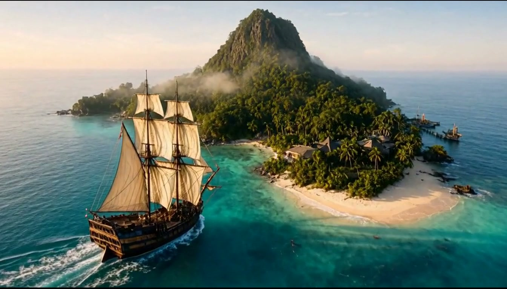

<h1>Generating a Short Film Locally</h1>

<em>A four-minute birthday film that became a three-day adventure with AI.</em>

<strong>4:10</strong> &nbsp;·&nbsp; <strong>12 scenes</strong> &nbsp;·&nbsp; <strong>3 days</strong> &nbsp;·&nbsp; <strong>16 GB VRAM</strong>

  <a href="https://github.com/korenko-git/local-ai-short-film/raw/refs/heads/main/docs/article/assets/film.mp4"><strong>▶ Watch the film</strong></a>
  &nbsp;&nbsp;·&nbsp;&nbsp;
  <a href="#about-the-project">Behind the scenes</a>
  &nbsp;&nbsp;·&nbsp;&nbsp;
  <a href="#tools-and-hardware">Tools &amp; hardware</a>

Russian dialogue · MP4, 71 MB · Article in English / Українська / Русский

---

## About the project

I made a four-minute birthday adventure using image, speech and video generation. This repository contains the production notes, prompts, workflows and the source of an [illustrated article](docs/article/README.md) about how it came together. Most generation ran on my PC; some water-puzzle keyframes were made with GPT Image through an external service.

The character arrives on an island, crosses a suspension bridge, finds a hidden path, solves a water puzzle and races through a closing gate. A chest, a talking parrot and a night-time zipline lead to the birthday ending.

The finished edit runs **4 minutes 10 seconds**, with **12 scenes at 1344 × 768 and 24 fps**. I generated images, speech and video separately and directed the revisions. GPT Luna worked through Codex to assemble and edit the footage with FFmpeg and Python, including the reusable achievement graphics.

The article follows the actual attempts: reference-guided camera moves, wind in the character's hair, a talking parrot, an extra hand inherited from a keyframe, changing maps, water flowing uphill and a failed hourglass flip. Comparisons of keyframes and footage show how these results emerged.

## Tools and hardware

| Task | Tools |
|---|---|
| Keyframes | Qwen Image 2.1; GPT Image for some water-puzzle frames |
| Speech | Drama 3 |
| Video | MiniMax H3 through FreeVideo; an early experiment with Wan 2.2 |
| Workflow assistance | Codex and ComfyUI MCP |
| Editing, audio mixing and graphics | GPT Luna through Codex, FFmpeg and Python |

My PC had an **RTX 5070 Ti with 16 GB VRAM, AMD Ryzen 7 9800X3D and 64 GB RAM**. Video generation took roughly 1.5 minutes per second of footage in my setup. During one speech-generation run, occupied system RAM reached about 52 GB. The article describes the memory optimizations and community tools that made this workflow possible.

## Explore the repository

- [Scene index](scenes/README.md) — story, scene notes and production history.
- [Production workflow](docs/SCENE-WORKFLOW.md) — keyframes, generation and editing.
- [ComfyUI MCP guide](docs/COMFY-MCP-LLM.md) — setup and working with the local tools.
- [Generation notes](docs/GENERATION-LEGACY.md) — model files, settings and earlier experiments.
- [Article source](docs/article/README.md) — translations, assets and build instructions.
- [Credits](CREDITS.md) — tools, music and source attribution.

