# Локальная генерация короткометражки

Как четырёхминутный фильм ко дню рождения превратился в трёхдневное приключение с Codex, ComfyUI и видеокартой на 16 ГБ.

Мой производственный дневник · Dmytro Korenko

Я хотел сделать личное поздравление в виде фильма: остров, пиратское досье, шаткий мост, древняя водяная головоломка и говорящий попугай. Получить картинки оказалось только началом. Основная работа — сохранить узнаваемость персонажа, показать понятные действия и собрать отдельные генерации в одну историю.

Полезным результатом стал повторяемый процесс: поставить действие, проверить связанные кадры, сгенерировать управляемые планы и поправить темп по сохранённым материалам. Последним исправлениям потребовался новый монтаж, а не очередной долгий видеорендер.

4:10 сборка v3 · 12 сцен · 24 кадра в секунду · 16 ГБ видеопамять GPU

<a id="models"></a>

## Быстрая первая проба и гораздо лучшая картинка

Первая видеопроба была на Wan 2.2. Она создала результат быстро, но качество этой более старой модели для моей задачи оказалось ужасным. Звук можно было использовать, картинку и действия — нет. Переход к MiniMax H3 через FreeVideo сильно изменил впечатление, особенно на крупных планах с мелкими деталями. За качество пришлось заплатить ожиданием, и хорошие опорные кадры всё равно оставались необходимы.

Что я использовал

| Задача | Инструмент | Роль |
| --- | --- | --- |
| Опорные кадры | Qwen Image 2.1 | Основная модель для опорных кадров. |
| Часть кадров головоломки | GPT Image | Альтернативные состояния и исправления третьего испытания. |
| Разборчивая речь | Drama 3 | Постоянные голоса, реплики, паузы и выразительность. |
| Видео | MiniMax H3 / FreeVideo | Движение, работа камеры и звуковое окружение. |
| Управление и монтаж | Codex, ComfyUI MCP, FFmpeg | Схемы, входы, записи запусков, сведение и сборка. |

Основная генерация изображений, речи и видео шла на моём ПК. Исключением стала часть опорных кадров водяной головоломки: для них я использовал GPT Image через внешний сервис.

MiniMax H3 — модель, FreeVideo — локальный инструмент, через который я её запускал. Его документация описывает VDN-H3 от OpenVDN и Video DeltaNet. В проекте я вызывал FreeVideo через CLI, а Qwen и Drama работали в локальных workflow ComfyUI через MCP.

Codex и ComfyUI MCP избавили от большой части ручной настройки. Агент находил установленные модели, разбирался с запуском, готовил схемы, подключал ноды и сохранял результаты. Постановка и отбор оставались за мной. Самыми полезными часто были конкретные замечания: река не движется, верёвка идёт не туда, персонаж вообще не коснулся знака.

<a id="memory"></a>

## 16 ГБ видеопамяти и около 52 ГБ оперативной

Конфигурация ПК

| Компонент | Характеристика |
| --- | --- |
| Видеокарта | NVIDIA GeForce RTX 5070 Ti |
| Видеопамять | 16 ГБ VRAM |
| Процессор | AMD Ryzen 7 9800X3D |
| Оперативная память | 64 ГБ RAM |

При одном из запусков генерации речи занятая оперативная память доходила примерно до 52 ГБ. Это общая занятая RAM моей системы в тот момент, а не отдельно измеренное потребление модели. У видеокарты своя память: 16 ГБ VRAM.

Запуск стал возможен благодаря работам других разработчиков. FreeVideo размещает веса между VRAM, RAM и диском, использует потоковую подгрузку, предварительную загрузку и вычисления частями. У меня применялся подготовленный int8 ConvRot cache. Qwen и его текстовый энкодер тоже работали с int8 ConvRot-весами, а установленный вариант Drama назывался w4a8experts_bf16. Готовые движки, сжатые веса и интеграции ComfyUI были важной частью конвейера.

За результатом стояли разработчики моделей, OpenVDN и Video DeltaNet, FreeVideo от FlashML-org, ComfyUI, интеграция Drama от PedroMarinhoDev и MCP-инструменты. Агент помогал соединить эти части. Сами оптимизации памяти он не изобретал.

Речь генерировалась сравнительно быстро даже на CPU. Видео в рабочем режиме занимало около полутора минут на секунду результата при 24 кадрах/с. Базовые настройки: 1344 × 768, один проход, 16 шагов. Десятисекундная проба могла означать пятнадцать минут ожидания. Неверный опорный кадр стоил дорого, поэтому проверка связанных изображений до запуска видео действительно окупалась.

<a id="pipeline"></a>

## Структура папок стала памятью фильма

Первые пробы показали разницу между описанием и сценой. Движения было мало, испытания читались плохо, сундук постоянно менялся. Я стал разбирать эпизоды на планы: показать проблему, реакцию, физическое действие и его результат. Проверка каждого этапа помогала больше, чем очередное удлинение промпта.

Когда пробы начали накапливаться, я организовал проект вокруг сцен и клипов. У каждой сцены появились собственные картинки, исходные видео, реплики, эффекты, workflow и монтаж. Общие лица, костюм, голоса и музыка лежали отдельно. Так агент возвращался к тому же персонажу и реквизиту вместо того, чтобы изобретать их заново.

> Сюжет → связанные кадры → просмотр → речь и видео → монтаж → просмотр

Рядом с заданием оставались промпт, media.json, входные изображения, seed и параметры. В README сцены записывались результаты, замечания, версии, одобрения и задачи. Главный индекс отслеживал всю историю. Завершённый рендер отличался от принятого мной результата; прерванная попытка не становилась готовым клипом.

```
scenes/
  README.md                  сюжет и статусы
  NN-scene-name/
    README.md                решения и журнал сцены
    frames/                  связанные кадры
    video/raw/               исходные генерации
    video/drafts/rejected/   отклонённые пробы
    audio/voice/             реплики
    audio/sfx/               точные эффекты
    workflows/               prompts, inputs, seeds, settings
    output/                  текущая полная сцена
      clips/                 копии принятых клипов
    work/archive/            прошлые сборки
shared/                      общие лица, голоса, музыка
output/assemblies/           общие сборки фильма
```

Оригиналы оставались в video/raw, копии принятых клипов — в output/clips, а в корне output — одна актуальная полная сцена. Прежние монтажи уходили в work/archive. Для некоторых переходов использовали реальный последний кадр предыдущего клипа, в том числе при уходе от сундука к ночному обрыву.

<a id="edit"></a>

## Монтаж руками GPT Luna

Монтаж я поручил GPT Luna, модели, которую использовал в агенте Codex для работы с видео. Я описывал нужные изменения, а Luna готовила и запускала команды FFmpeg и Python-скрипты: подрезала и соединяла клипы, совмещала звук с изображением, фиксировала отдельные области кадра и накладывала плашки. Правки вносились в готовые материалы, поэтому для них не требовалось заново генерировать видео.

### Как Luna проверяла сгенерированное видео

После генерации Luna проверяла результат перед монтажом. Через FFmpeg она извлекала по одному кадру в секунду, уменьшала их до 448 × 256 и собирала в контактный лист 4 × 2. Так последовательность действий можно было рассмотреть на одной картинке: где находится персонаж, как меняется поза и произошло ли нужное действие. Длительность файла она проверяла через ffprobe. На примере ниже ролик длился 6,58 секунды; семь кадров заняли семь ячеек, последняя осталась пустой.

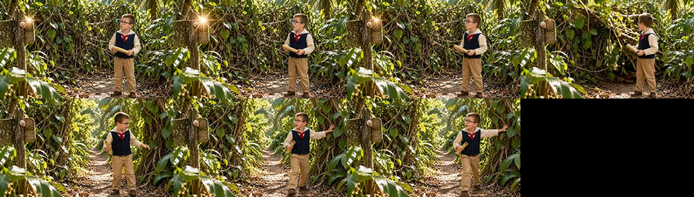

Контактный лист проверки сцены 7 · Семь кадров из ролика длиной 6,58 секунды, по одному кадру в секунду.

Если в результате была явная ошибка, Luna могла сама отбраковать его и перезапустить генерацию. Так произошло с бегом в девятой сцене: вместо переноса движения видеогайд увёл результат в аниме-стиль. В рабочем чате Luna написала:

> «Этот вариант не подходит: режим видеогайда почти скопировал аниме… Отбраковываю его».

Затем она перезапустила задачу по изображениям персонажа и коридора. Видеореференс использовала как образец постановки, переведя его в текстовое описание: крупный план со штрихами скорости, обход камеры на бок и бег с искрами. Это позволило сохранить нужный характер движения без копирования аниме-персонажа.

Подробный разбор и итоговый клип: [Поставить скорость по референсу](#speed-reference).

### Неподвижный текст поверх зацикленной анимации

Видео для досье получилось длиной около 9–10 секунд, а озвучка с клонированным голосом длилась 20 секунд. Чтобы изображение продолжалось до конца записи, короткую анимацию пришлось повторять. Вместе с ней заново запускалось и появление текста: надписи исчезали и возникали снова. Luna быстро решила проблему: вырезала область с уже появившимся текстом из последнего кадра и зафиксировала её поверх видео, оставив анимацию персонажа в движении. В итоге получилось что-то вроде фотографий из «Гарри Поттера», где персонажи на снимках повторяют движения.

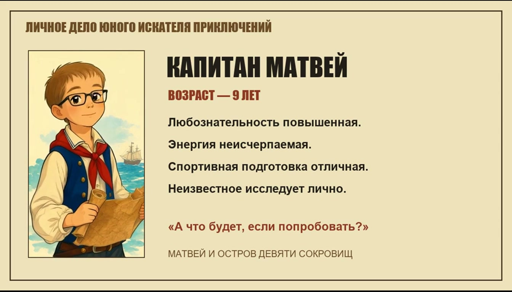

00:25 · Рисованное досье — намеренное исключение из фотореалистичного мира фильма.

### Склейки и монтажный ритм

Одинаковый опорный кадр в конце одного клипа и начале другого сохранял композицию, но иногда создавал заметную остановку. Luna подрезала повторяющиеся позы и сдвигала вместе с монтажом реплики и ачивки. Фразу диктора о неудачной попытке она тоже перенесла в таймлайне на момент после того, как действительно произошёл ошибочный поворот.

Последние замечания к монтажу

| Проблема | Правка |
| --- | --- |
| Ачивка моста слишком рано | Перенос на приземление, 1:10. |
| Зависания на стыках | Срез повторяющихся поз во втором и третьем испытаниях. |
| Долгая остановка у колеса | В v3 убраны ещё 2,5 секунды. |
| Попугай слишком сильно обрезан | Возвращены пролёт и реакция: +1,75 секунды. |
| Ожидание после сборов | Убраны 2,25 секунды перед уходом. |
| Лишняя первая поездка | Клип исключён перед поздравлением. |

Сборка v2 длилась 253,2 секунды, v3 — 250,3. Несколько секунд важны, когда персонаж будто ждёт начала следующего клипа.

### Один шаблон ачивки на четыре испытания

Инфографика приятно удивила. GPT Luna создала общий SVG-шаблон с медальоном, рамкой, цветами и шрифтом. Для каждого испытания она подставляла название и номер, сохраняя одинаковое оформление. Плашки добавлялись при монтаже: можно было править текст, угол экрана и момент появления без новой видеогенерации.


Пример из общего SVG-шаблона GPT Luna: ачивка за первое испытание. Текст остаётся русским, как в фильме.

[SVG template](../article/assets/achievement-template.svg) · [Python renderer](../article/assets/render_trial_achievement.py)

Рядом с шаблоном лежит render_trial_achievement.py. Скрипт принимает номер, название и общее количество испытаний, проверяет номер и подбирает размер шрифта под длину названия. Он сохраняет SVG с подставленными значениями и отдельно рисует прозрачный PNG через Pillow: сначала в двойном разрешении, затем уменьшает до 400 × 92. Именно такой PNG можно накладывать на видео через FFmpeg.

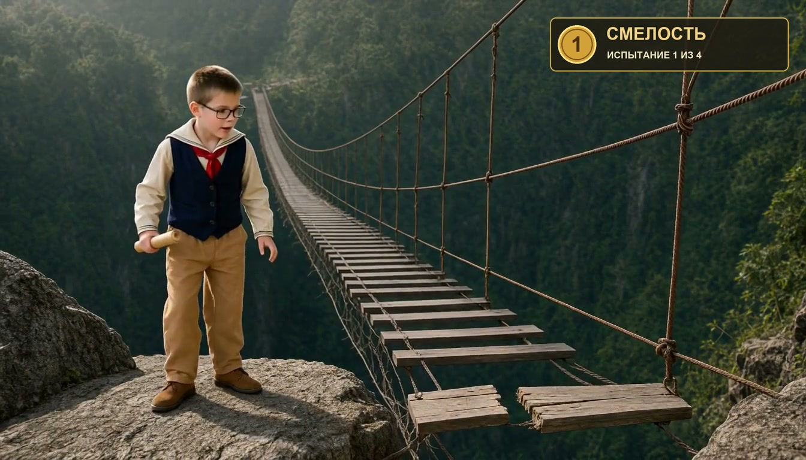

01:11 · Плашка появляется после приземления независимо от исходного видео.

Сначала ачивка за смелость выскакивала до завершения моста. Luna перенесла её на приземление, примерно на 1:10 фильма. Разделение слоёв также позволило изменить количество испытаний на четыре, сохранив одинаковое оформление.

<a id="voice"></a>

## Исполнение из нескольких попыток

Чтобы голоса не менялись между сценами, я использовал общие голосовые референсы, а конкретные реплики сохранял рядом с видео своей сцены. У диктора, коротких реплик персонажа и попугая были свои закреплённые референсы. Теги выразительности Drama 3, паузы и подсказки произношения заметно влияли на результат.

Для досье я предоставил запись с клонированным голосом, звук часов и добавил море.

Попугаю хотелось раскатистого «р», паузы после пушек и азартного финала. В одной пробе был прекрасный невнятный начальный крик, другая оборвалась. Я объединил первые две секунды раннего крика с более поздней речью, удалив её первые полсекунды. Случайность стала актёрской деталью: открывается сундук, птица просыпается с криком и выдаёт заученную речь.

FreeVideo давал полезные море, листву, птиц и иногда музыку вместе с изображением. Разборчивую речь я делал Drama 3. В сцене скорости видеомодель добавила бессмысленные голоса, и звук пришлось дополнительно править. Точные трески, удары и механизмы можно было добавлять отдельными эффектами.

Не весь звук генерировался. В ранних сценах использовалась Adventures in Adventureland Кевина Маклауда, а море — Joseph Sardin / BigSoundBank. Сведения об источниках и лицензиях я сохранил в проекте; атрибуция есть и в конце статьи.

<a id="details"></a>

## Удачные моменты

### Две важные смены камеры

Второй клип испытания с мостом — облёт персонажа и моста. Камера раскрывает глубину долины и показывает высоту, которую предстоит преодолеть. Это помогает передать опасность перехода через движение камеры.

[Второй клип моста: облёт раскрывает высоту.](../article/assets/bridge-camera.mp4)

Второй клип испытания на любознательность решает другую задачу: смена ракурса показывает тупик от лица персонажа. Пустой заблокированный проход виден до его входа, поэтому зритель успевает понять проблему. Это работает лучше, чем сразу показать кого-то, стоящего возле знака.

[Второй клип второго испытания: тупик с нового ракурса.](../article/assets/curiosity-camera.mp4)

### Волосы на ветру

В четвёртой сцене, когда персонаж получает карту на палубе, у него двигаются волосы от ветра. Совсем мелкая деталь, а я сразу её заметил. Вместе с морем за кораблём движение помогает поверить в настоящую продуваемую палубу, а не в портрет на подставленном фоне.

[Сцена 4 · Видно, как морской ветер двигает волосы, пока персонаж разворачивает карту.](../article/assets/hair-wind.mp4)

### Забрать вещи из сундука

Мне понравилось, как MiniMax показал сбор подарка. Руки, крышка, одежда, самокат и шлем должны взаимодействовать в одной сцене. Сначала я заменил неубедительный кадр, где сундук будто открылся сам: теперь персонаж держит крышку. Позже он действительно забирает вещи.

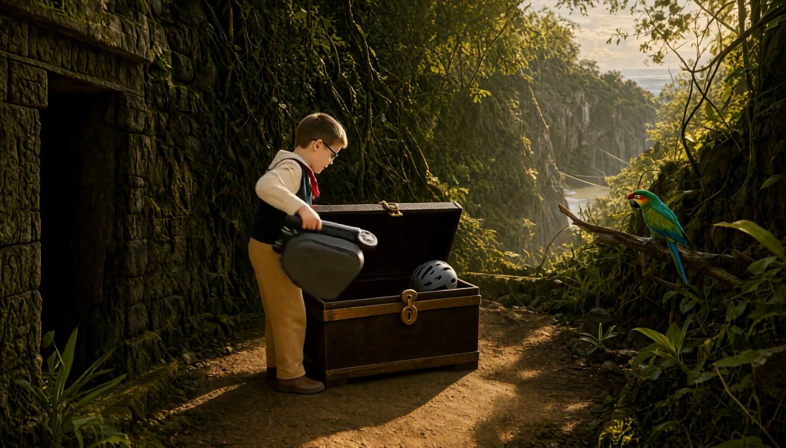

03:33 · Персонаж сам достаёт подарок из сундука.

### Попугай — одна из удач

Попугай получился особенно хорошо. Для него я сделал отдельную видеовставку: клюв пытается двигаться в такт человеческой пиратской реплике. Разборчивую речь дала Drama 3, видео — исполнение. Синхронизация не идеальная, но попугай выглядит убедительно: будто повторяет заученную фразу.

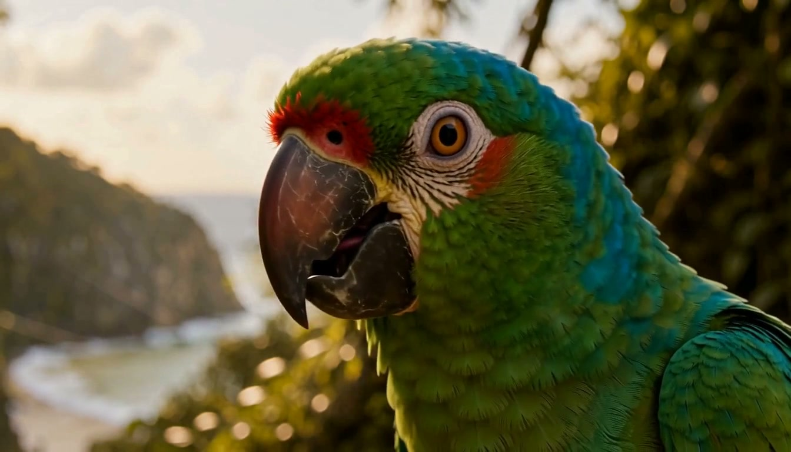

03:24 · Движение клюва и отдельно сгенерированный человеческий голос создают персонажа.

<a id="speed-reference"></a>

### Поставить скорость по референсу

Для четвёртого испытания мне хотелось большего, чем просто пробежка к воротам. Я принёс аниме-референс с выразительными разворотами камеры, размытием фона и искрами из-под ног. Попросил, чтобы камера обходила персонажа сзади на бок и показывала профильный бег, а в начале были крупный план и штрихи скорости из референса. На контактном листе ниже виден ритм, который я хотел перенести.

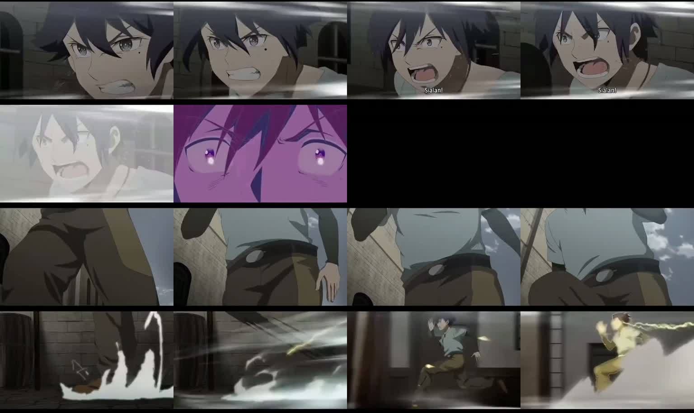

Референс движения · Контактный лист из аниме-клипа, который я предоставил во время работы. Это кадры референса, а не генерации моего фильма.

В одной из первых попыток я подал весь ролик как видеогайд, и результат скопировал лишнее: аниме-стиль и чужого персонажа. В удачном варианте остались только изображения моего персонажа и коридора. Весь референс разобрали на текстовую постановку: удивлённое лицо со штрихами сверху и снизу, задний трекинг, обход на бок, размытые стены и золотые искры у обуви. Штрихи и искры создала сама FreeVideo внутри кадра.

[Принятая вставка скорости v5 · 6,58 секунды, обход камеры сзади на бок, сгенерированные штрихи и искры, сохранённая музыка и новая реплика.](../article/assets/speed-dynamic.mp4)

<a id="artifacts"></a>

## Артефакты генерации

### Карта для зрителя вместо карты для персонажа

На 00:50–00:52 персонаж будто читает карту, но её рисунок обращён к зрителю. Без отдельного опорного кадра для этого действия видеомодель поставила персонажа так, словно он демонстрирует реквизит в камеру. На 03:01–03:03 ошибка повторяется, а сама карта уже отличается от той, что была в начале. Стоило заранее сделать общий референс карты и других важных предметов фильма и использовать его во всех сценах.

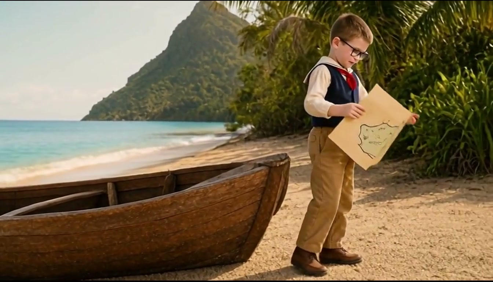

00:50–00:52 · Рисунок карты виден зрителю, хотя персонаж должен читать её.

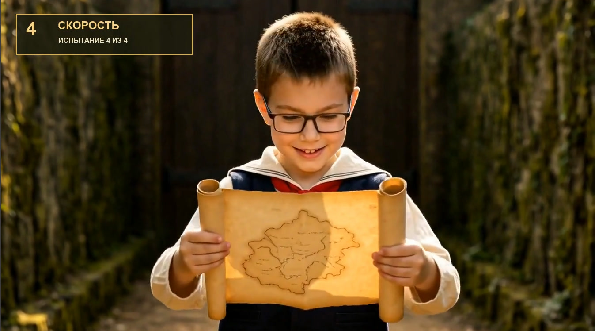

03:01–03:03 · Повтор той же позы; рисунок и форма карты уже другие.

### Опорный кадр моста: референсы помогли не во всём

Сначала агент пытался сделать опорный кадр через локальный Qwen. Но вместо испытания на смелость получался безопасный мостик: то короткий переход почти у земли, то прочная деревянная конструкция с надёжными перилами. Даже когда появилась глубокая долина, сам мост выглядел слишком основательным. Попытка заменить дерево верёвками тоже ещё не дала нужной ненадёжности.

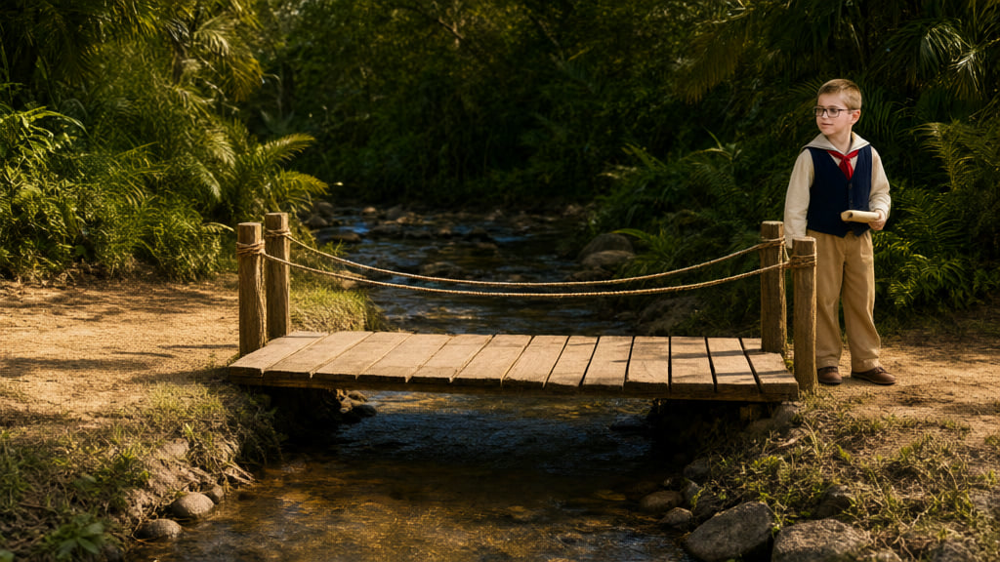

Ранняя попытка Qwen · Короткий мостик над мелким ручьём почти не выглядит испытанием.

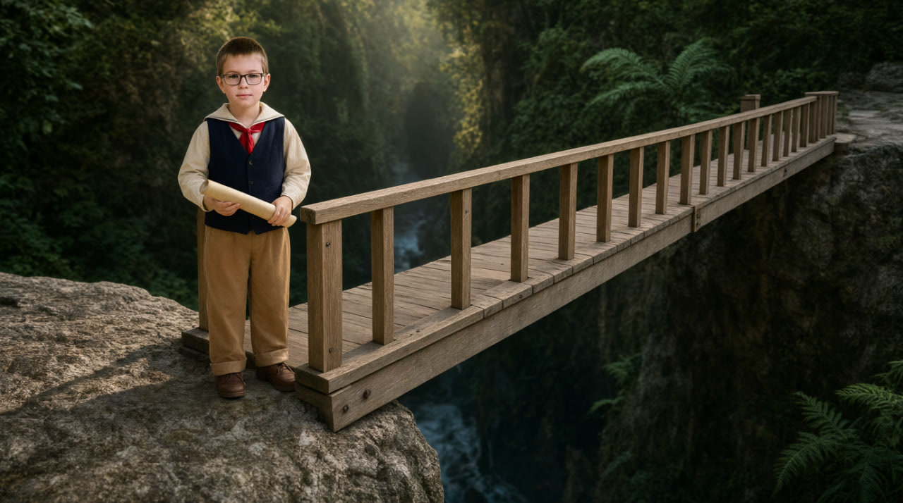

Следующая попытка · Высота появилась, но мост похож на прочный пешеходный переход.

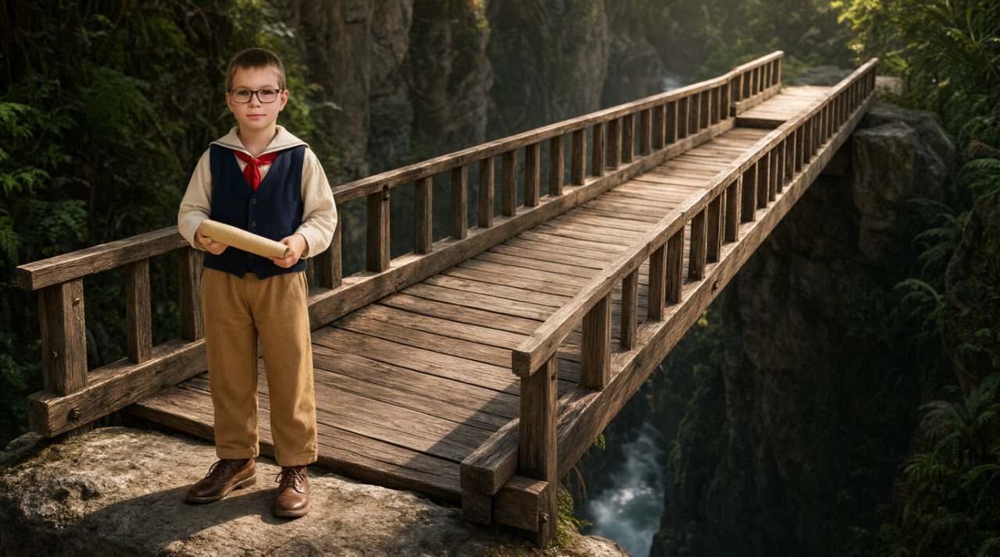

Ещё один вариант · Широкий настил и массивные перила сохраняют ощущение надёжности.

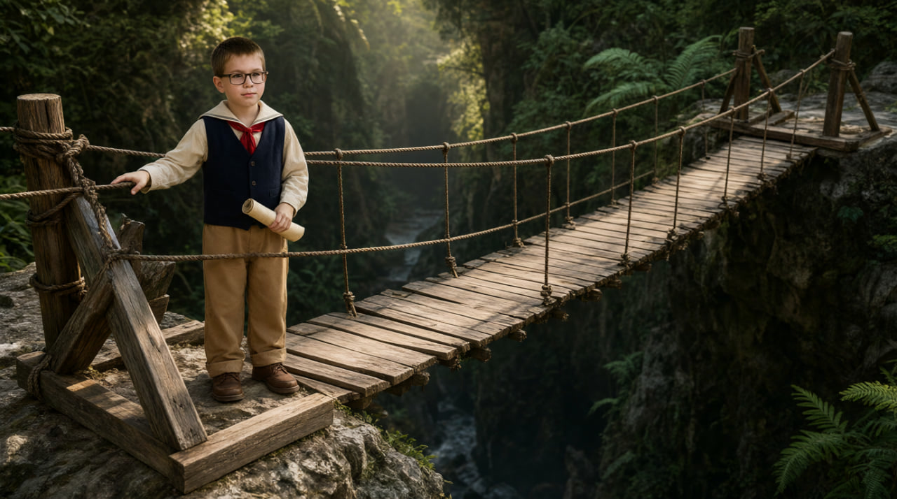

Верёвочный вариант · Материалы изменились, но настил и опоры всё ещё выглядят слишком основательно.

Желаемый мост удалось получить только после того, как я передал фотографии мостов как референсы: длинный подвесной пролёт, редкие доски и выразительный провис. Это помогло точнее показать, что именно должно выглядеть опасным.

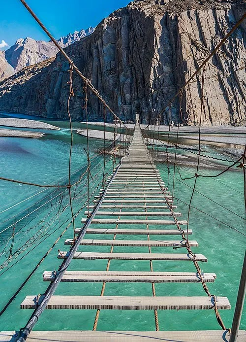

Предоставленный мной фотореференс · Редкие доски и верёвочная конструкция. Это фотография реального моста, не кадр фильма.

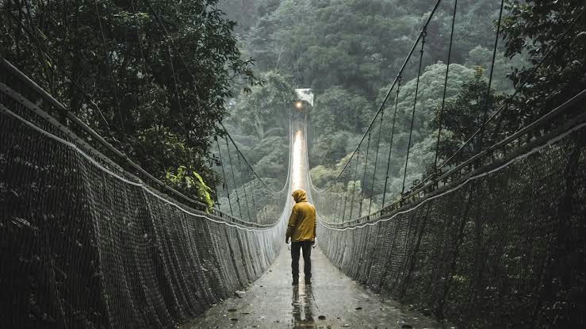

Второй предоставленный фотореференс · Длинный подвесной пролёт и заметный провис. Это фотография реального моста, не генерация проекта.

После референсов появились нужные масштаб и ощущение опасности, но в опорном кадре остались новые ошибки: верёвочное ограждение было только с одной стороны, а у персонажа оказалось три руки — одна держит верёвку, ещё две свёрнутую карту. Агент их пропустил, хотя другие неудачные картинки часто пересоздавал. Я и сам заметил лишнюю руку только ближе к завершению работы. К этому моменту я стал слишком доверять проверкам Luna и сам смотрел на результаты менее внимательно. На 00:56–00:58 она уже перешла в итоговое видео. Решил оставить этот пример как напоминание: после улучшения композиции нужно заново тщательно проверить и анатомию, и устройство окружения.

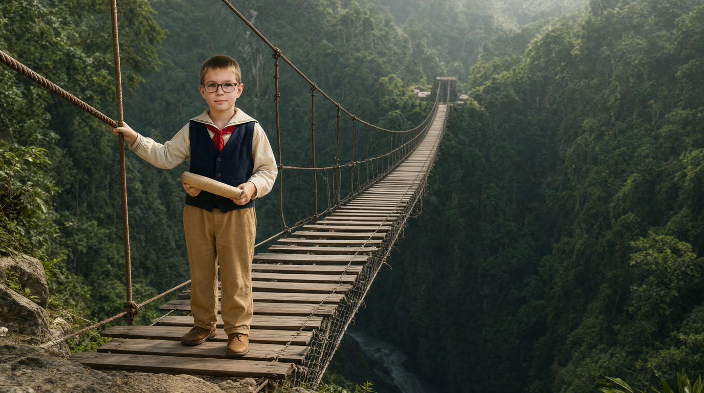

Опорный кадр моста · Лишняя кисть уже видна у свёрнутой карты.

Причина такого доверия была понятна: явный брак Luna часто замечала сама. Например, при подготовке конечного кадра локальной модели подавались исходный кадр, референс внешности персонажа и просьба изменить его положение. Вместо того чтобы использовать референс только для сохранения внешности, модель добавила его в сцену как второго персонажа. Luna отбраковала такой вариант. На фоне этих проверок лишнюю руку в кадре моста было легче пропустить и мне, и агенту.

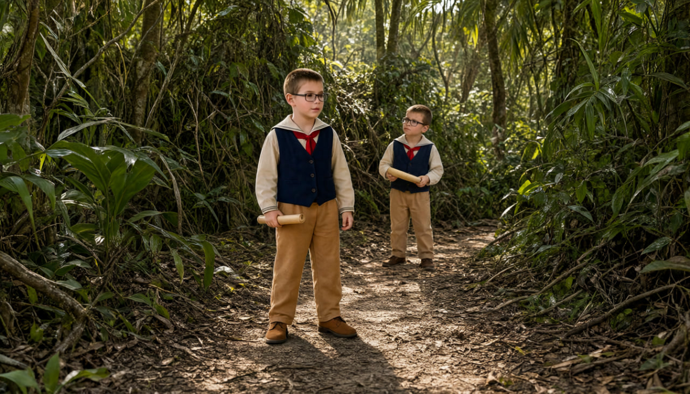

Отбракованный опорный кадр · Референс внешности превратился во второго персонажа, хотя нужно было изменить положение одного.

### Qwen не понял головоломку, GPT Image усложнил кадры

Для третьего испытания не удалось получить подходящие опорные кадры через Qwen: в моих попытках он плохо понимал перспективу и саму идею водяной головоломки. Ниже — ранние варианты постановки и более поздний кадр GPT Image. Между попытками менялись ракурс, форма каналов, положение персонажа и устройство механизма.

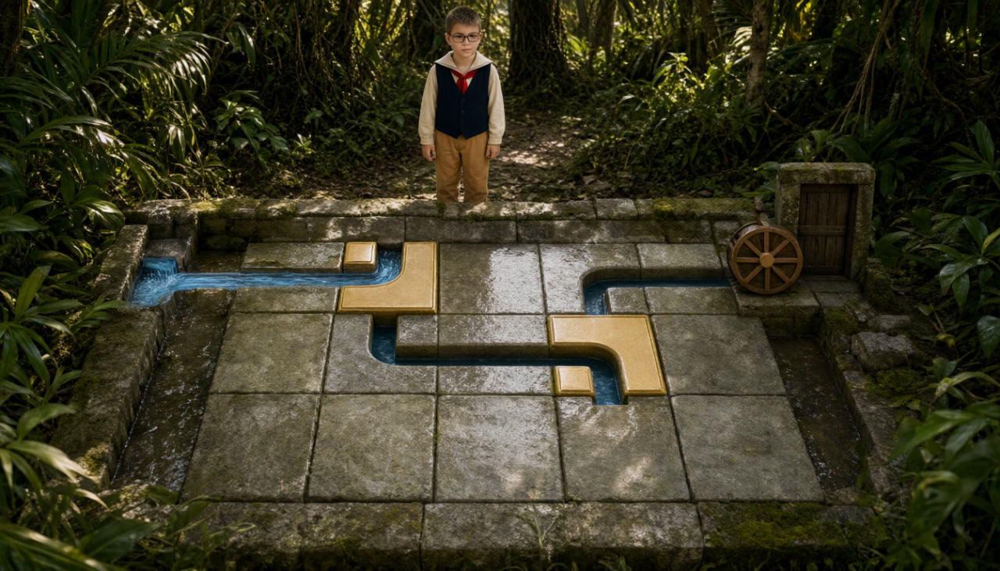

Ранняя попытка · Персонаж и головоломка показаны почти фронтально.

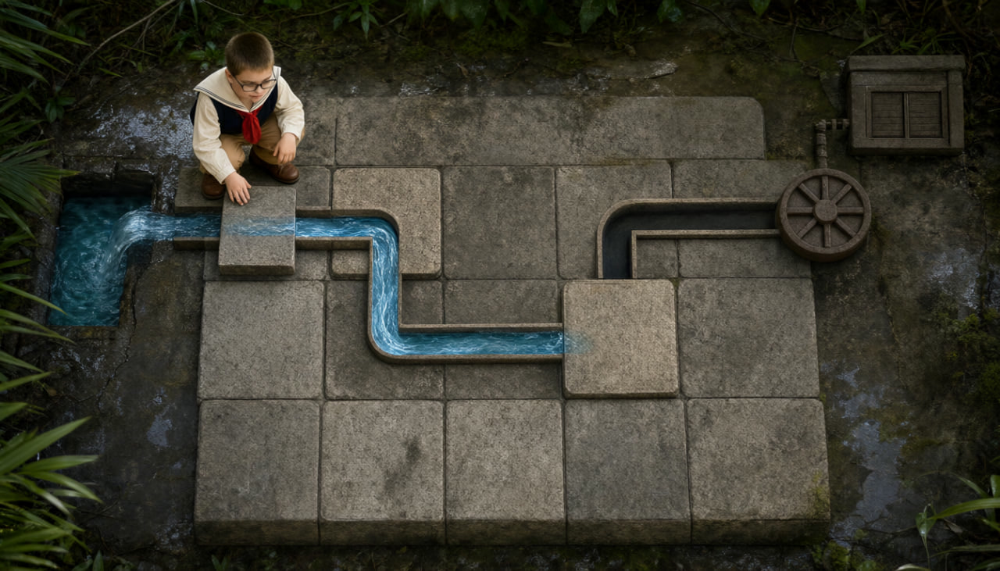

Ранняя попытка · Вид сверху и квадратные элементы каналов.

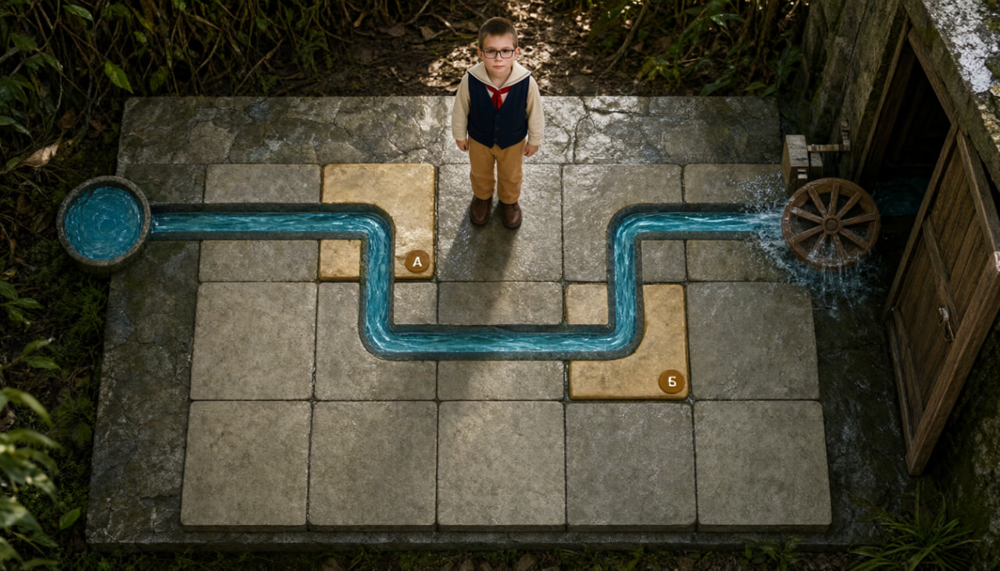

Ранняя попытка · Другие перспектива, положение персонажа и устройство потока.

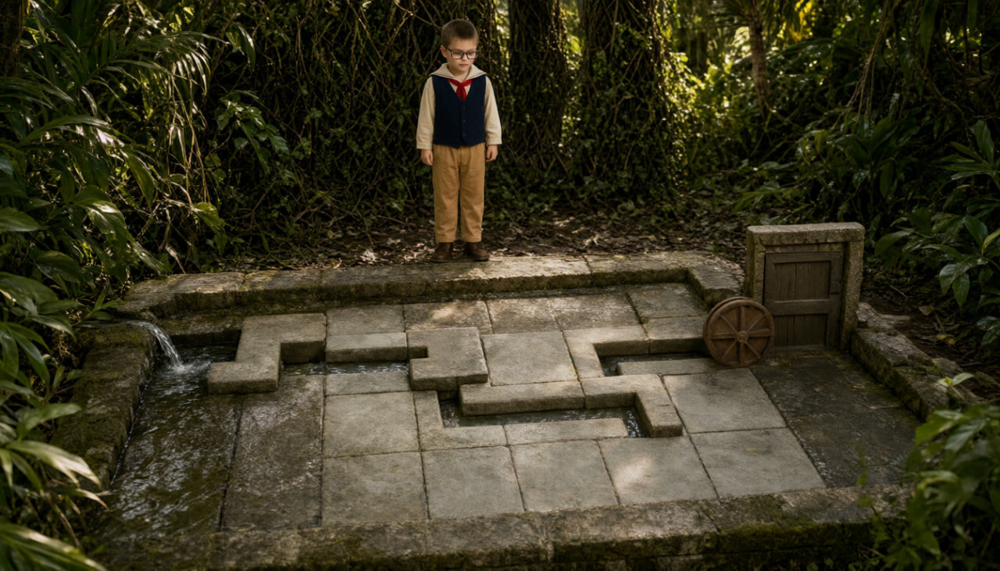

Ранняя попытка · Меняются геометрия площадки и глубина каналов.

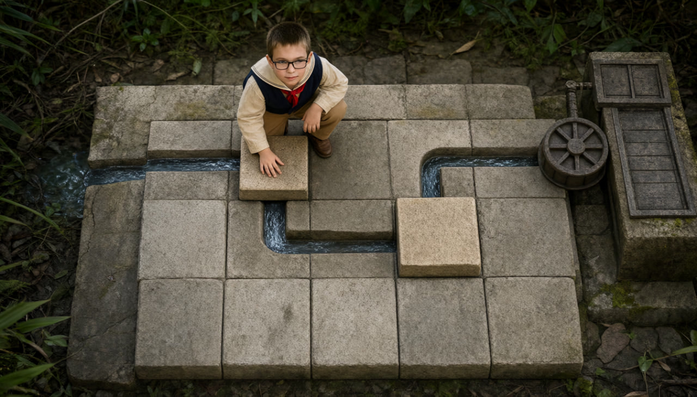

Ранняя попытка · Новый ракурс взаимодействия с квадратным элементом.

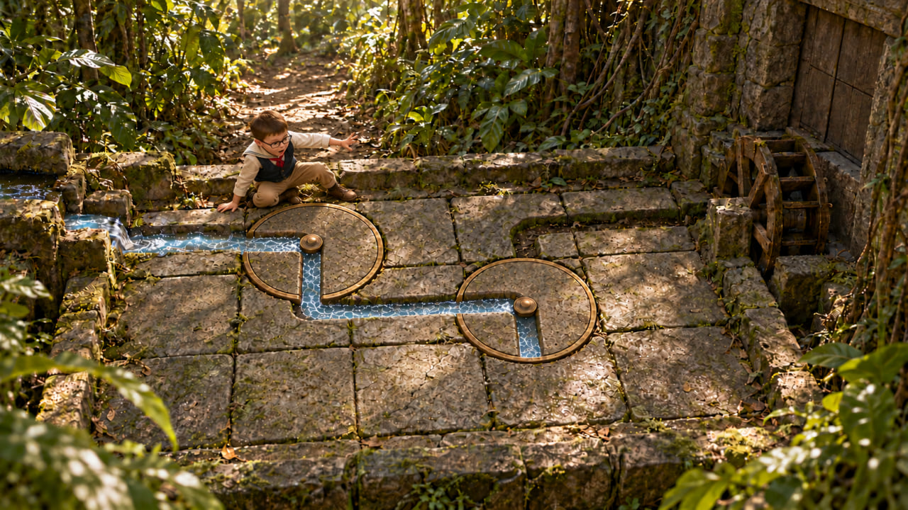

Более поздний кадр GPT Image · Круглые диски и понятнее поставленное действие, но много мелких деталей.

GPT Image лучше понял задумку сцены, но его картинки оказались перегружены мелкими деталями и визуальным шумом. Ключевые кадры отличались друг от друга, а в видео терялись лицо персонажа, детали и стабильность изображения. Я пробовал добавлять референс персонажа на этапе видео, затем пробовал без него. Думаю, если бы я вручную подчистил и согласовал ключевые кадры GPT Image, эти фрагменты могли бы получиться лучше. Такую обработку я не проверял.

### «Имитация» воды на локальной модели

Третье испытание было самым требовательным. Вода должна течь, упираться в неверно повёрнутый канал, после одного движения доходить до следующей преграды, а в конце вращать колесо. Но модель постоянно забывала о движении воды: поток оставался неподвижным, хотя действие сцены зависело именно от него. Всё же один удачный момент получился — в клипе ниже после правильного поворота диска вода проходит дальше по каналу. В этом фрагменте MiniMax удивила меня тем, насколько убедительно выглядело движение.

[Испытание 3 · Правильный первый поворот: вода проходит через диск А и останавливается внутри Б; колесо ещё неподвижно.](../article/assets/water-first-turn.mp4)

В промпте приходилось уточнять и неподвижные объекты: колесо не должно начинать вращаться только от того, что где-то в кадре есть вода.

### Вода поднимается по стенке

В опорном кадре решённой головоломки сместился ручей: выход канала оказался ниже точки подачи воды на колесо. Видеомодель продолжила эту геометрию, и поток пошёл вверх по каменной стенке прямо в колесо. В движении это не так заметно, но последовательность стоп-кадров хорошо показывает нарушение физики. Удачный поворот первого диска выше не означает, что вся водяная сцена получилась правильно.

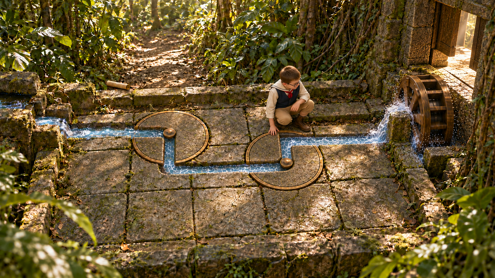

Опорный кадр решённой головоломки · Между каналом и колесом уже нарушен перепад высот.

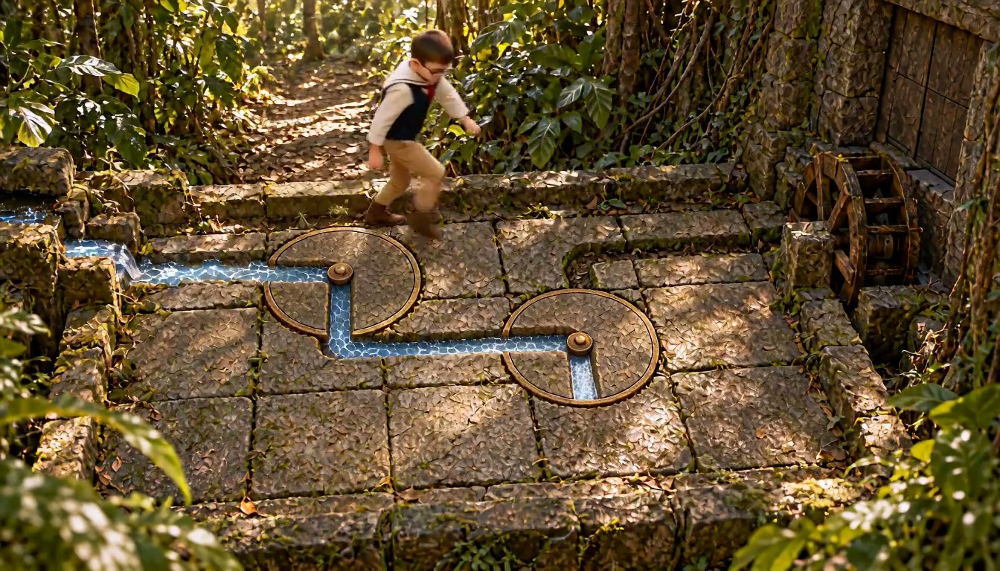

02:23 · Перед поворотом второго диска.

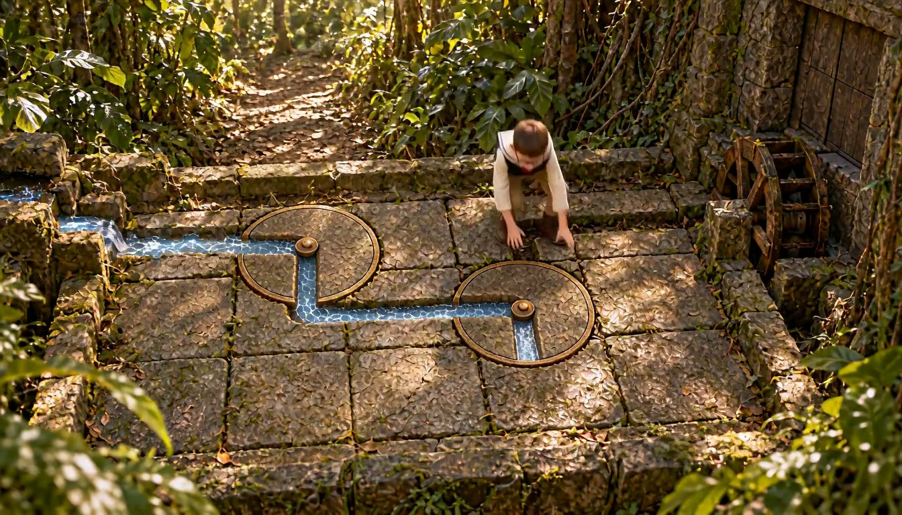

02:24 · Диск меняет положение.

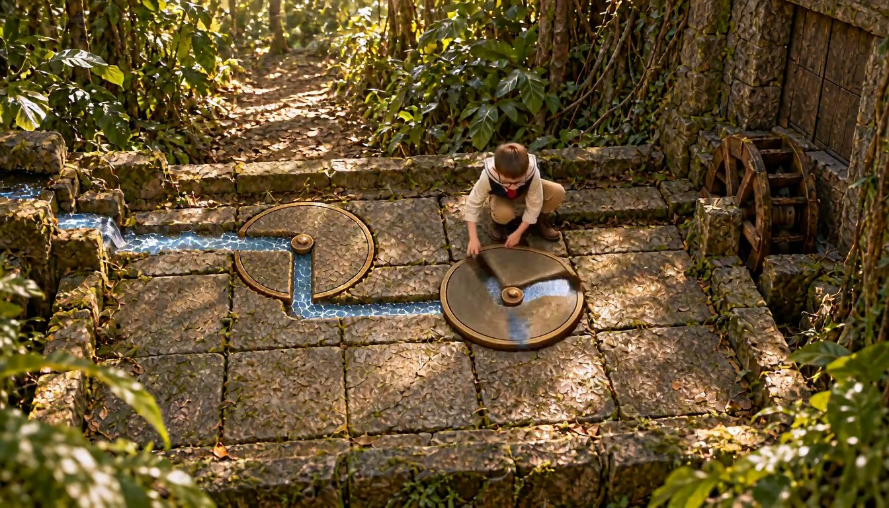

02:25 · Вода доходит до выхода канала.

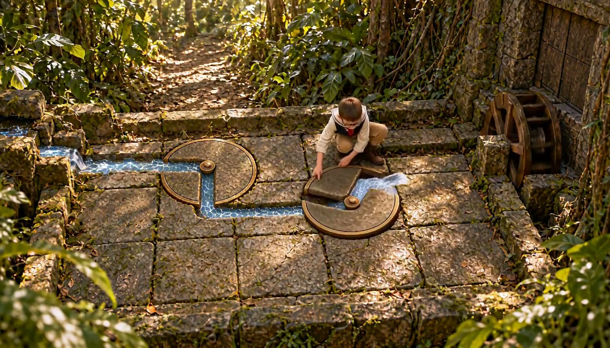

02:25,2 · Канал заканчивается ниже точки подачи на колесо.

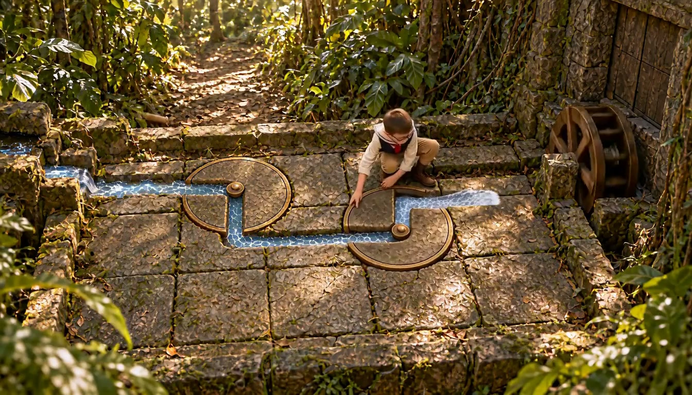

02:25,4 · Поток начинает подниматься вдоль стенки.

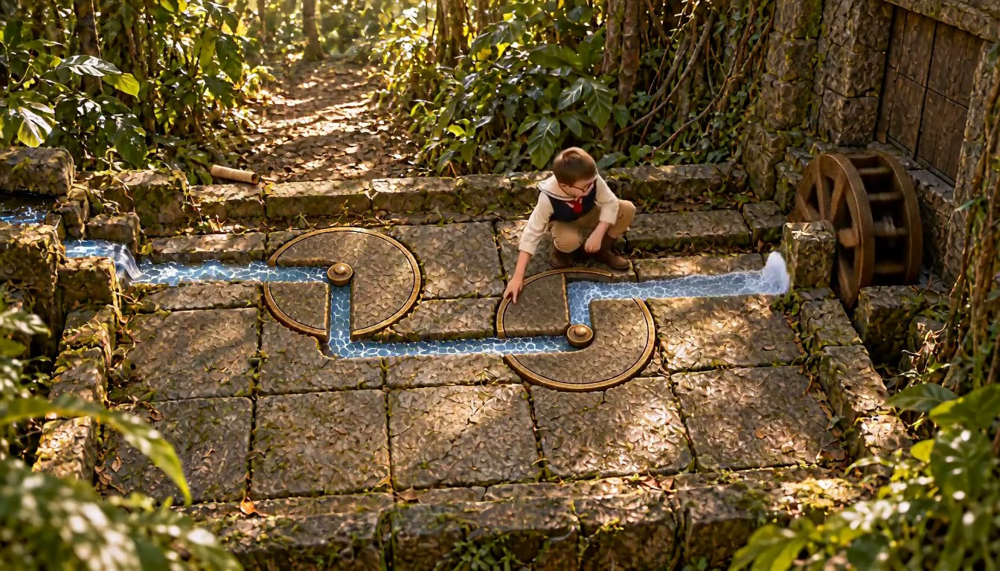

02:25,7 · Вода достигает верхней части каменного выступа.

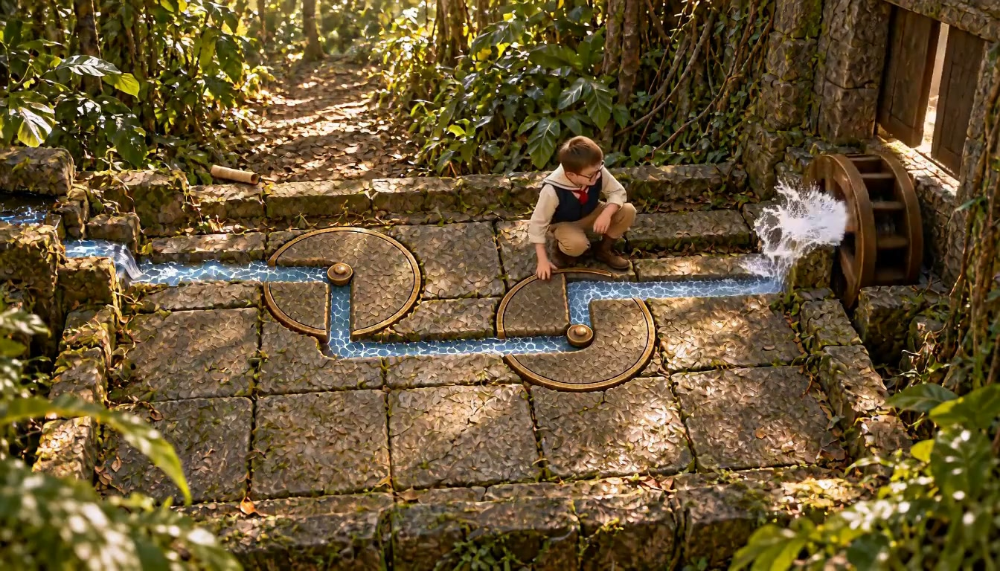

02:26,1 · Поток и брызги поднимаются к колесу.

### Переворот песочных часов

На 02:34–02:36 модель плохо перевернула песочные часы: вместо понятного вращения стеклянной части получилась неубедительная деформация. Песок и механизм выглядели слабее удачного движения воды или работы камеры. Я оставил этот фрагмент в фильме как пример ошибки.

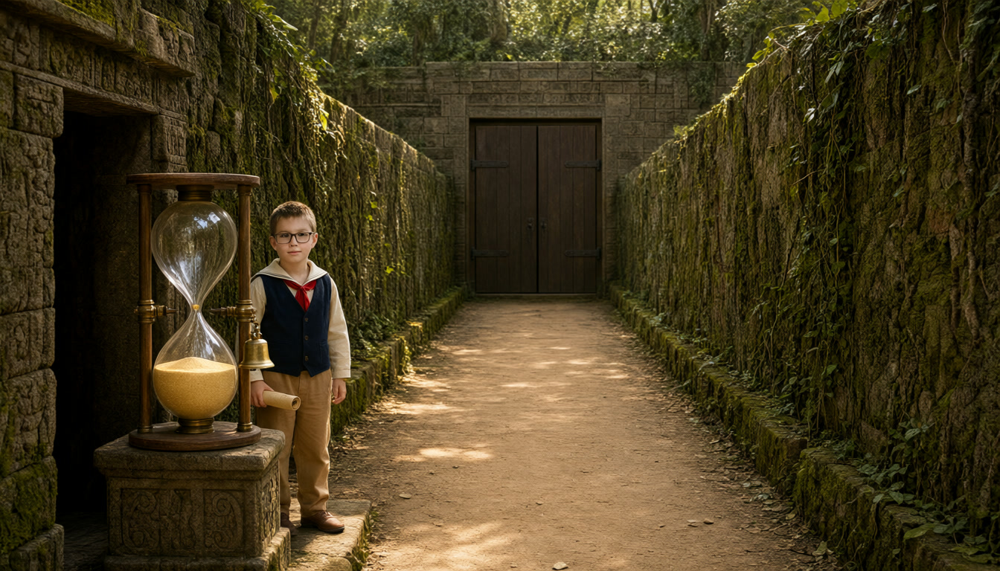

Начальное состояние · Песок внизу, ворота закрыты.

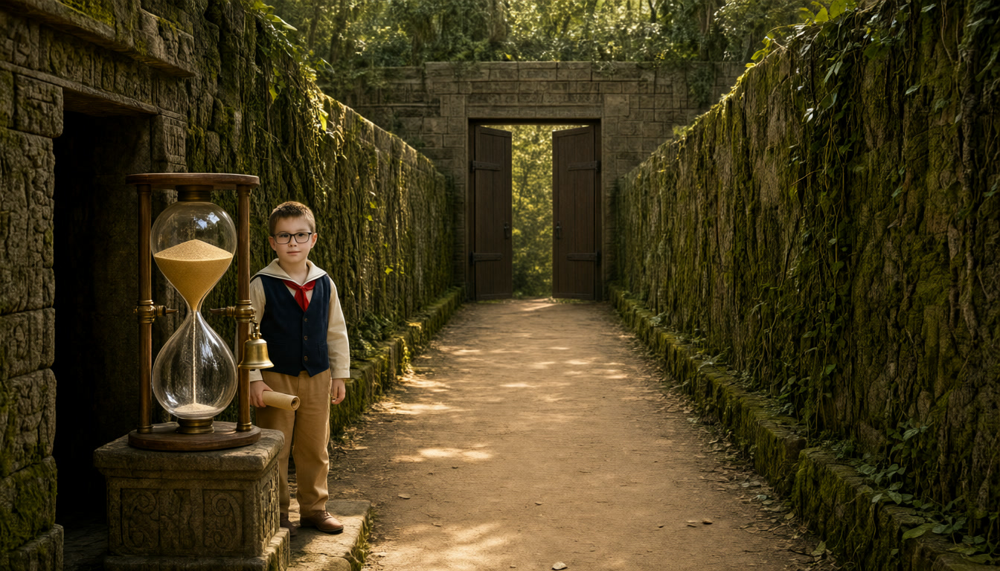

Опорный кадр таймера · Песок наверху, ворота открыты. Это состояние после запуска, а не промежуточная фаза переворота.

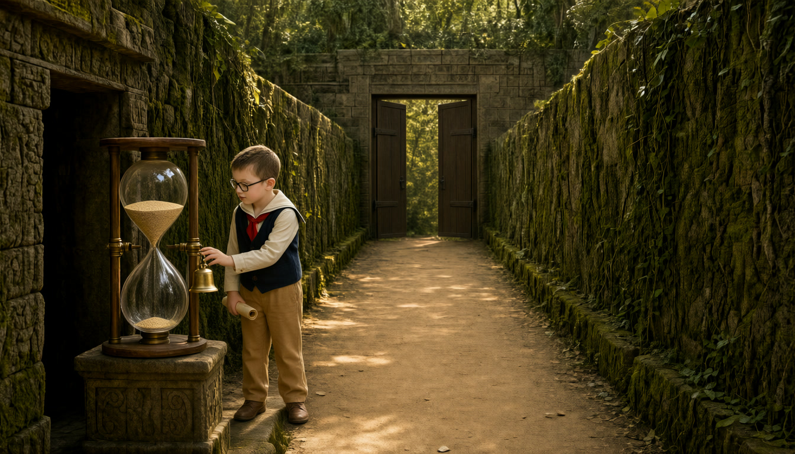

Фактический конечный кадр видеозадания · Персонаж касается колокольчика; песок уже наверху.

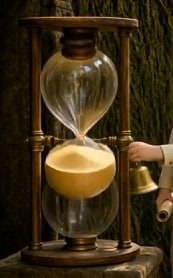

02:34–02:36 · Неубедительное промежуточное состояние часов в видео.

Я проверил сохранённые prompt.txt и media.json задания scene09-start-v1. В промпте прямо сказано: после звонка стеклянная часть переворачивается на горизонтальных боковых осях, деревянная стойка остаётся неподвижной, а песок перемещается вместе со стеклом. То есть само указание на переворот не было забыто. Фактическими входами были начальный кадр и кадр касания колокольчика, а не показанная выше пара establish/timer. Ни один из них не показывает промежуточную фазу вращения.

По этим материалам я вижу две возможные сложности: модели нужно было самой восстановить траекторию переворота между конечными состояниями, а в те же 6,5 секунды вместить звонок, движение песка, открытие ворот и реакцию персонажа. Это возможные причины, а не доказанный диагноз. Более явный промежуточный кадр и отдельный короткий план переворота стоило бы проверить в следующей попытке.

[02:34–02:36,5 · Фрагмент итогового фильма: ошибка переворота видна в движении.](../article/assets/artifact-hourglass.mp4)

### Речь видеомодели превращается в неразборчивые звуки

На 02:58–03:01 в фильме остался пример неудачной речи. В моих генерациях видеомодель плохо справлялась с голосами на языках, отличных от английского: вместо понятной реплики появлялись неразборчивые звуки. Я решил сохранить этот момент как пример ограничения. Для разборчивой русской речи в остальных репликах я использовал Drama 3.

[02:58–03:01 · Оригинальный звук итогового фильма сохранён: здесь важна именно неразборчивая речь.](../article/assets/artifact-speech.mp4)

<a id="film"></a>

## Четыре минуты локального кино

[Смотреть фильм](../article/assets/film.mp4)

Рабочая сборка v3 · 4:10,250 · русская речь

<a id="story"></a>

## От пиратского досье до падающей звезды

Дальше — весь сюжет, включая подарок и финал.

Всё началось с девятилетия и подарка — серого двухколёсного самоката. Мне хотелось, чтобы он стал наградой в конце приключения. В первоначальном «Острове девяти сокровищ» сокровища соответствовали качествам и пожеланиям: смелости, любознательности, смекалке, скорости, ловкости, настойчивости, верным друзьям, удаче и большой мечте. В процессе из-за долгой генерации и ограниченного времени я сократил маршрут до четырёх испытаний. Название сохранило связь с девятилетием.

Пиратскую атмосферу и шутливо-серьёзное досье подсказал «Остров сокровищ». Досье я сделал рисованным, а остальные сцены — с фотореалистичным персонажем по фотографическим референсам.

### Корабль, папка и карта

Парусник подходит к острову с бухтой. В каюте пират кладёт на стол папку с личным делом. Досье представляет девятилетнего искателя приключений, штамп принимает его в команду. На палубе уже фотореалистичный персонаж получает карту и задание пройти четыре испытания. Лодка доставляет его к берегу; он проверяет маршрут и идёт в джунгли.

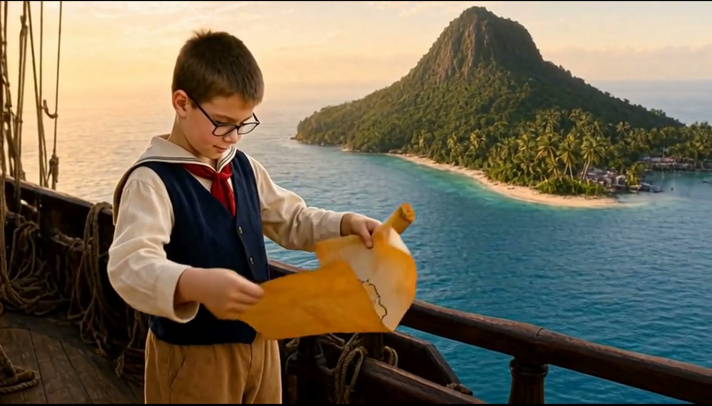

00:42 · Получение карты. Даже волосы на ветру помогают поверить в морскую сцену.

### Первое испытание: смелость

Впереди длинный подвесной мост над глубокой долиной. Он шатается, камера облетает его и показывает высоту, одна из досок трескается. Персонаж в последний момент добирается до другого берега. Только после приземления появляется ачивка «Смелость».

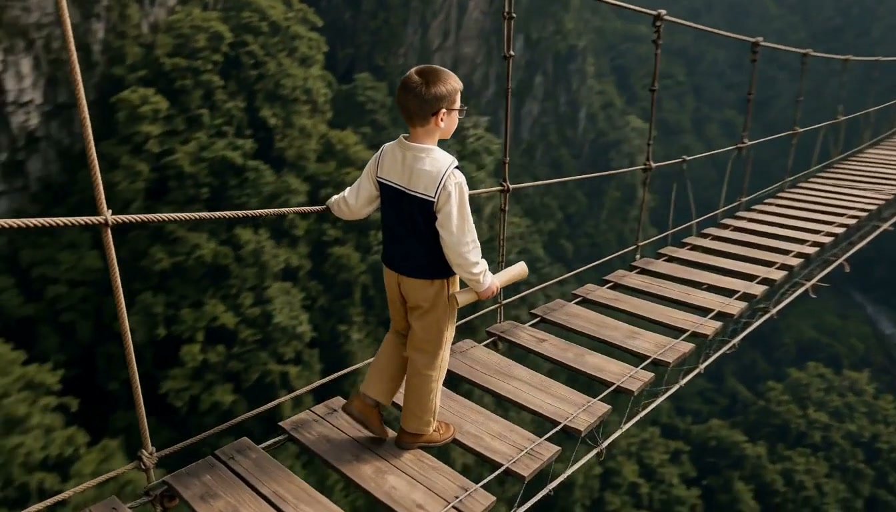

01:04 · Мосту понадобились убедительная высота, ненадёжные доски и движение.

### Второе испытание: любознательность

Тропа упирается в лианы. Камера показывает тупик от лица персонажа до того, как он входит в кадр. Он осматривается, чешет голову и замечает мигающую ракушку на знаке: «О!» Подходит и физически поворачивает доску. В тот же момент заросли расходятся, открывая путь. Персонаж уходит с картой в проход и получает ачивку за любознательность.

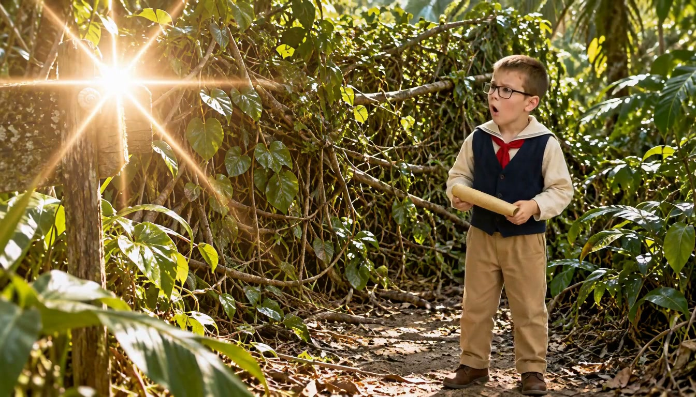

01:31 · Знак поворачивается от действия персонажа, и вслед за этим открывается проход.

### Третье испытание: смекалка

За проходом каменная площадка: каналы, вода, два круглых поворотных диска, колесо и закрытая дверь. Я построил головоломку по принципу игры «сантехник». Персонаж кладёт карту и неверно поворачивает диск. Попытка решить всё силой тоже не помогает: пока он крутит колесо руками, дверь открыта, но стоит отпустить его и вытереть пот — снова закрывается.

Нужно соединить маршрут воды. После правильного поворота первого диска поток доходит до второго препятствия. После второго — достигает колеса и вращает его, удерживая дверь открытой. Теперь персонаж может оставить механизм и пройти дальше. Третья ачивка — за смекалку.

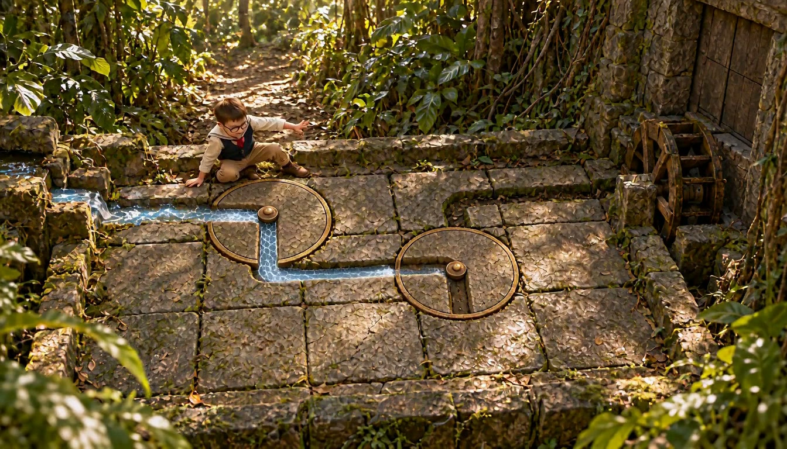

02:21 · Положение дисков определяет, куда действительно может пройти вода.

### Четвёртое испытание: скорость

Колокольчик запускает большие песочные часы и открывает дальнюю калитку. Персонаж засматривается на песок, пока время уже идёт. Затем убирает карту и срывается с места. Монтаж чередует бег, убывающий песок и закрывающийся проход. Он успевает, переводит дыхание и получает четвёртую ачивку. Остаётся добраться до отмеченного сокровища.

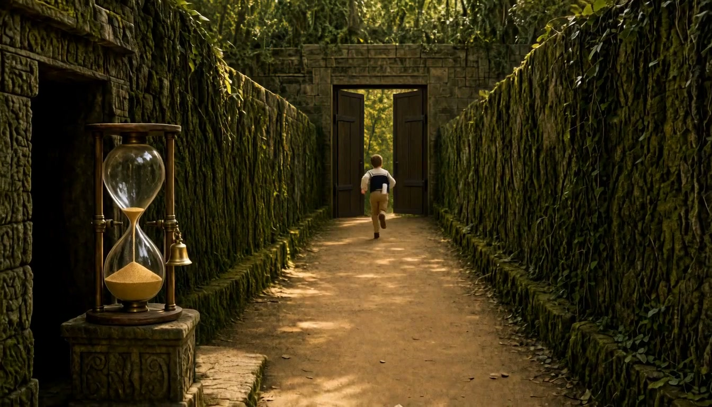

02:54 · Забег на время к закрывающемуся проходу.

### Сундук и необычное судно

Над бухтой персонаж находит сундук, убирает карту: «Вот ты где!» Сам поднимает крышку. Внутри сложенный серый самокат и шлем. Диктор объявляет новейшее достижение кораблестроения, а рядом с сундуком с криком просыпается попугай и произносит заученную пиратскую шутку.

> «Два колеса, один руль, ни одной пушки. Зато какая скорость!»

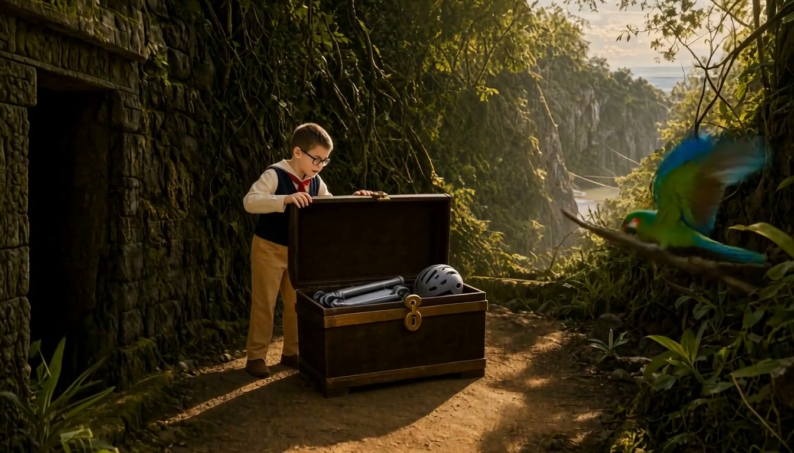

03:16 · Персонаж держит крышку, а попугай завершает раскрытие подарка шуткой.

### Ночной спуск и поздравление

Я решил завершить историю в духе серии Tomb Raider: после находки сокровища персонаж спускается по наклонному тросу прямо на пляж. Самокат помещается в чехол. В окончательной постановке персонаж держится обеими руками за рукоять подвесного бегунка — вместо рассмотренного раньше варианта с ледорубами.

День сменяется ночью. Диктор поручает новому капитану открывать маршруты и не забывать о шлеме, персонаж спускается к бухте. На пляже персонаж уже со шлемом и самокатом смотрит на загорающиеся звёзды. Падающая звезда сопровождает заключительное пожелание с днём рождения.

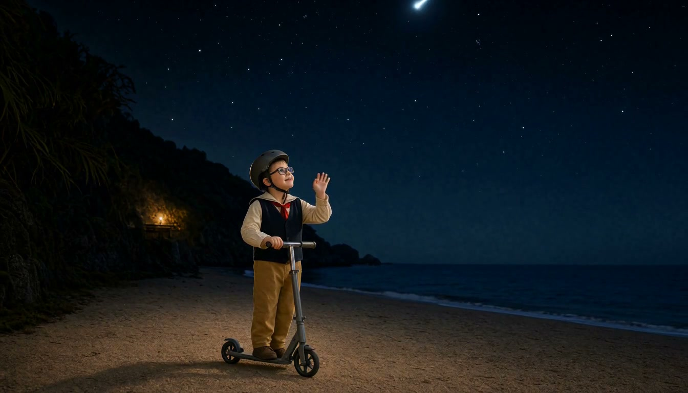

04:06 · Приключение заканчивается личным поздравлением на берегу.

### О материалах

Я восстановил этот рассказ по рабочим чатам, журналам сцен, workflow и таймлайну v3. Иллюстрации включают кадры фильма, исходные опорные изображения и присланные мной фрагменты; подписи различают их. Таймкоды относятся к итоговой сборке. Сравнение моделей, движение воды, деградация картинок, скорость и RAM — наблюдения моих попыток, а не контролируемые бенчмарки.

Музыка: Kevin MacLeod — Adventures in Adventureland, CC BY 4.0, смонтирована и сведена с репликами и эффектами. Море: Joseph Sardin / BigSoundBank, CC0. Инструменты и модели сохраняют лицензии своих разработчиков.

[Credits](../CREDITS.md)
