# Локальна генерація короткометражки

Як чотирихвилинний фільм до дня народження перетворився на триденну пригоду з Codex, ComfyUI та відеокартою на 16 ГБ.

Мій виробничий щоденник · Dmytro Korenko

Я хотів зробити особисте привітання у вигляді фільму: острів, піратське досьє, хиткий міст, давня водяна головоломка й папуга, що розмовляє. Отримати картинки виявилося лише початком. Основна робота — зберегти впізнаваність персонажа, показати зрозумілі дії та зібрати окремі генерації в одну історію.

Корисним результатом став повторюваний процес: поставити дію, перевірити пов’язані кадри, згенерувати керовані плани та виправити темп за збереженими матеріалами. Останнім змінам знадобився новий монтаж, а не черговий тривалий відеорендер.

4:10 збірка v3 · 12 сцен · 24 кадри на секунду · 16 ГБ відеопам’ять GPU

<a id="models"></a>

## Швидка перша спроба й набагато краща картинка

Перша відеоспроба була на Wan 2.2. Вона створила результат швидко, але якість цієї старішої моделі для мого задуму виявилася жахливою. Звук можна було використати, картинку та дії — ні. Перехід до MiniMax H3 через FreeVideo сильно змінив враження, особливо на великих планах із дрібними деталями. За якість довелося заплатити очікуванням, а хороші опорні кадри все одно залишалися необхідними.

Що я використовував

| Завдання | Інструмент | Роль |
| --- | --- | --- |
| Опорні кадри | Qwen Image 2.1 | Основна модель для опорних кадрів. |
| Частина кадрів головоломки | GPT Image | Альтернативні стани та виправлення третього випробування. |
| Розбірливе мовлення | Drama 3 | Сталі голоси, репліки, паузи та виразність. |
| Відео | MiniMax H3 / FreeVideo | Рух, робота камери й звукове оточення. |
| Керування та монтаж | Codex, ComfyUI MCP, FFmpeg | Схеми, входи, записи запусків, зведення та збірка. |

Основна генерація зображень, мовлення та відео відбувалася на моєму ПК. Винятком стала частина опорних кадрів водяної головоломки: для них я використовував GPT Image через зовнішній сервіс.

MiniMax H3 — модель, FreeVideo — локальний інструмент, через який я її запускав. Його документація описує VDN-H3 від OpenVDN і Video DeltaNet. У проєкті я викликав FreeVideo через CLI, а Qwen і Drama працювали в локальних workflow ComfyUI через MCP.

Codex і ComfyUI MCP позбавили значної частини ручного налаштування. Агент знаходив установлені моделі, розбирався із запуском, готував схеми, підключав ноди та зберігав результати. Постановка й відбір залишалися за мною. Найкориснішими часто були конкретні зауваження: річка не рухається, мотузка йде не туди, персонаж узагалі не торкнувся знака.

<a id="memory"></a>

## 16 ГБ відеопам’яті та близько 52 ГБ оперативної

Конфігурація ПК

| Компонент | Характеристика |
| --- | --- |
| Відеокарта | NVIDIA GeForce RTX 5070 Ti |
| Відеопам’ять | 16 ГБ VRAM |
| Процесор | AMD Ryzen 7 9800X3D |
| Оперативна пам’ять | 64 ГБ RAM |

Під час одного із запусків генерації мовлення зайнята оперативна пам’ять сягала приблизно 52 ГБ. Це загальна зайнята RAM моєї системи в той момент, а не окремо виміряне споживання моделі. У відеокарти своя пам’ять: 16 ГБ VRAM.

Запуск став можливим завдяки роботам інших розробників. FreeVideo розміщує ваги між VRAM, RAM і диском, використовує потокове підвантаження, попереднє завантаження та обчислення частинами. У мене застосовувався підготовлений int8 ConvRot cache. Qwen та його текстовий енкодер теж працювали з int8 ConvRot-вагами, а встановлений варіант Drama називався w4a8experts_bf16. Готові рушії, стиснуті ваги та інтеграції ComfyUI були важливою частиною конвеєра.

За результатом стояли розробники моделей, OpenVDN і Video DeltaNet, FreeVideo від FlashML-org, ComfyUI, інтеграція Drama від PedroMarinhoDev та MCP-інструменти. Агент допомагав з’єднати ці частини. Самих оптимізацій пам’яті він не винаходив.

Мовлення генерувалося порівняно швидко навіть на CPU. Відео в робочому режимі займало близько півтори хвилини на секунду результату за 24 кадрів/с. Базові налаштування: 1344 × 768, один прохід, 16 кроків. Десятисекундна проба могла означати п’ятнадцять хвилин очікування. Невдалий опорний кадр коштував дорого, тому перевірка пов’язаних зображень до запуску відео справді окупалася.

<a id="pipeline"></a>

## Структура тек стала пам’яттю фільму

Перші спроби показали різницю між описом і сценою. Руху було мало, випробування погано читалися, скриня постійно змінювалася. Я почав розбирати епізоди на плани: показати проблему, реакцію, фізичну дію та її результат. Перевірка кожного етапу допомагала більше, ніж чергове подовження промпту.

Коли спроби почали накопичуватися, я організував проєкт навколо сцен і кліпів. Кожна сцена отримала власні картинки, вихідні відео, репліки, ефекти, workflow та монтаж. Спільні обличчя, костюм, голоси й музика лежали окремо. Так агент повертався до того самого персонажа й реквізиту замість того, щоб винаходити їх заново.

> Сюжет → пов’язані кадри → перегляд → мовлення та відео → монтаж → перегляд

Поруч із завданням залишалися промпт, media.json, вхідні зображення, seed і параметри. У README сцени записувалися результати, зауваження, версії, схвалення та завдання. Головний індекс відстежував усю історію. Завершений рендер відрізнявся від прийнятого мною результату; перервана спроба не ставала готовим кліпом.

```
scenes/
  README.md                  сюжет і статуси
  NN-scene-name/
    README.md                рішення та журнал сцени
    frames/                  пов’язані кадри
    video/raw/               вихідні генерації
    video/drafts/rejected/   відхилені спроби
    audio/voice/             репліки
    audio/sfx/               точні ефекти
    workflows/               prompts, inputs, seeds, settings
    output/                  поточна повна сцена
      clips/                 копії прийнятих кліпів
    work/archive/            попередні збірки
shared/                      спільні обличчя, голоси, музика
output/assemblies/           загальні збірки фільму
```

Оригінали залишалися у video/raw, копії прийнятих кліпів — у output/clips, а в корені output — одна поточна повна сцена. Попередні монтажі йшли до work/archive. Для деяких переходів використовували справжній останній кадр попереднього кліпу, зокрема під час виходу від скрині до нічної скелі.

<a id="edit"></a>

## Монтаж руками GPT Luna

Монтаж я доручив GPT Luna, моделі, яку використовував в агенті Codex для роботи з відео. Я описував потрібні зміни, а Luna готувала й запускала команди FFmpeg та Python-скрипти: підрізала й з’єднувала кліпи, поєднувала звук із зображенням, фіксувала окремі ділянки кадру й накладала плашки. Правки вносилися в готові матеріали, тому для них не потрібно було заново генерувати відео.

### Як Luna перевіряла згенероване відео

Після генерації Luna перевіряла результат перед монтажем. Через FFmpeg вона витягувала по одному кадру на секунду, зменшувала їх до 448 × 256 і збирала в контактний аркуш 4 × 2. Так послідовність дій можна було розглянути на одній картинці: де перебуває персонаж, як змінюється поза й чи відбулася потрібна дія. Тривалість файлу вона перевіряла через ffprobe. У прикладі нижче ролик тривав 6,58 секунди; сім кадрів зайняли сім комірок, остання залишилася порожньою.

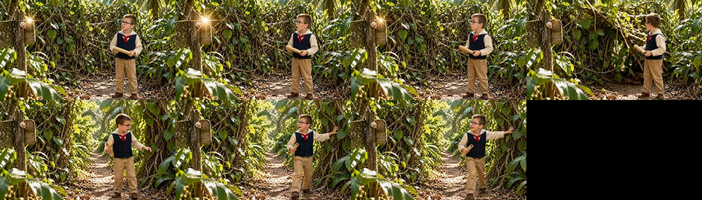

Контактний аркуш перевірки сцени 7 · Сім кадрів із ролика тривалістю 6,58 секунди, по одному кадру на секунду.

Якщо в результаті була явна помилка, Luna могла сама відбракувати його й перезапустити генерацію. Так сталося з бігом у дев’ятій сцені: замість перенесення руху відеогайд повів результат в аніме-стиль. У робочому чаті Luna написала:

> «Цей варіант не підходить: режим відеогайда майже скопіював аніме… Відбраковую його».

Потім вона перезапустила завдання за зображеннями персонажа й коридору. Відеореференс використала як зразок постановки, переклавши його в текстовий опис: великий план зі штрихами швидкості, обхід камери збоку й біг з іскрами. Це дозволило зберегти потрібний характер руху без копіювання аніме-персонажа.

Докладний розбір і підсумковий кліп: [Поставити швидкість за референсом](#speed-reference).

### Нерухомий текст поверх зацикленої анімації

Відео для досьє вийшло завдовжки близько 9–10 секунд, а озвучення з клонованим голосом тривало 20 секунд. Щоб зображення тривало до кінця запису, коротку анімацію довелося повторювати. Разом із нею заново запускалася й поява тексту: написи зникали та виникали знову. Luna швидко розв’язала проблему: вирізала ділянку з уже проявленим текстом з останнього кадру й зафіксувала її поверх відео, залишивши анімацію персонажа в русі. У результаті вийшло щось на кшталт фотографій із «Гаррі Поттера», де персонажі на знімках повторюють рухи.

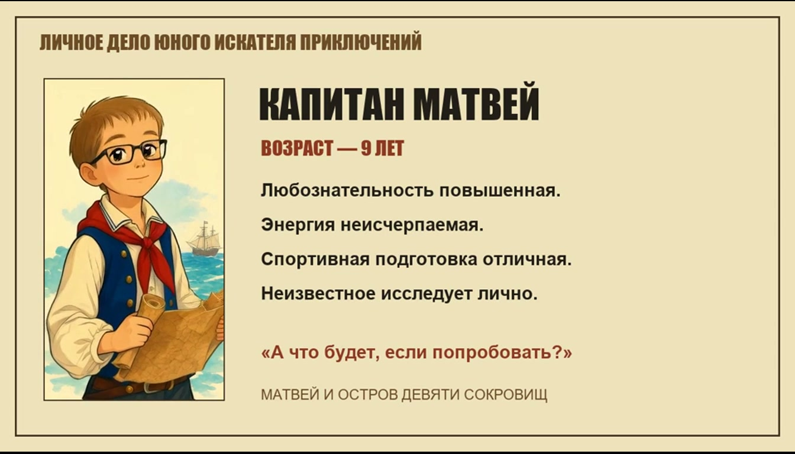

00:25 · Мальоване досьє — навмисний виняток із фотореалістичного світу фільму.

### Склейки й монтажний ритм

Однаковий опорний кадр наприкінці одного кліпу й на початку іншого зберігав композицію, але іноді створював помітну зупинку. Luna підрізала повторювані пози й пересувала разом із монтажем репліки та досягнення. Фразу диктора про невдалу спробу вона теж перенесла на таймлайні на момент після того, як справді відбувся помилковий поворот.

Останні зауваження до монтажу

| Проблема | Правка |
| --- | --- |
| Досягнення моста зарано | Перенесення на приземлення, 1:10. |
| Завмирання на стиках | Зріз повторюваних поз у другому та третьому випробуваннях. |
| Довга зупинка біля колеса | У v3 прибрано ще 2,5 секунди. |
| Папугу надто обрізано | Повернуто проліт і реакцію: +1,75 секунди. |
| Очікування після зборів | Прибрано 2,25 секунди перед виходом. |
| Зайва перша поїздка | Кліп вилучено перед привітанням. |

Збірка v2 тривала 253,2 секунди, v3 — 250,3. Кілька секунд важливі, коли персонаж ніби чекає початку наступного кліпу.

### Один шаблон досягнення на чотири випробування

Інфографіка приємно здивувала. GPT Luna створила спільний SVG-шаблон із медальйоном, рамкою, кольорами та шрифтом. Для кожного випробування вона підставляла назву й номер, зберігаючи однакове оформлення. Плашки додавалися під час монтажу: можна було правити текст, кут екрана й момент появи без нової відеогенерації.


Приклад зі спільного SVG-шаблона GPT Luna: досягнення за перше випробування. Текст залишається російським, як у фільмі.

[SVG template](../article/assets/achievement-template.svg) · [Python renderer](../article/assets/render_trial_achievement.py)

Поруч із шаблоном лежить render_trial_achievement.py. Скрипт приймає номер, назву й загальну кількість випробувань, перевіряє номер і підбирає розмір шрифту під довжину назви. Він зберігає SVG із підставленими значеннями й окремо малює прозорий PNG через Pillow: спочатку в подвійному розмірі, потім зменшує до 400 × 92. Саме такий PNG можна накладати на відео через FFmpeg.

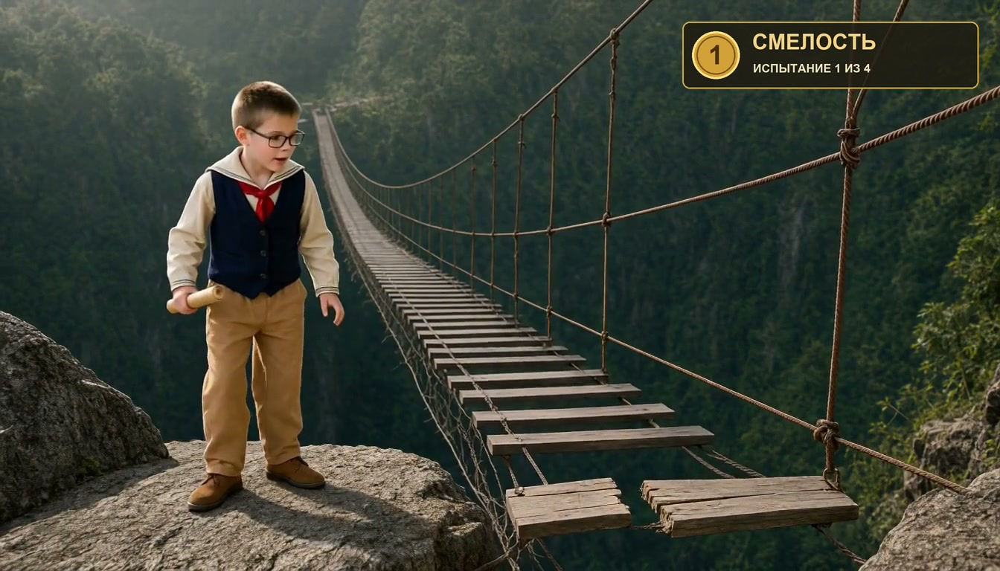

01:11 · Плашка з’являється після приземлення незалежно від вихідного відео.

Спочатку досягнення за сміливість з’являлося до завершення моста. Luna перенесла його на приземлення, приблизно на 1:10 фільму. Розділення шарів також дозволило змінити кількість випробувань на чотири, зберігши однакове оформлення.

<a id="voice"></a>

## Виконання з кількох спроб

Щоб голоси не змінювалися між сценами, я використовував спільні голосові референси, а конкретні репліки зберігав поруч із відео своєї сцени. У диктора, коротких реплік персонажа й папуги були свої закріплені референси. Теги виразності Drama 3, паузи та підказки вимови помітно впливали на результат.

Для досьє я надав запис із клонованим голосом, звук годинника й додав море.

Для папуги хотілося розкотистого «р», паузи після гармат і азартного фіналу. В одній пробі був чудовий нерозбірливий початковий крик, інша обірвалася. Я поєднав перші дві секунди раннього крику з пізнішим мовленням, видаливши його перші пів секунди. Випадковість стала акторською деталлю: відкривається скриня, птах прокидається з криком і видає завчену промову.

FreeVideo давав корисні море, листя, птахів та іноді музику разом із зображенням. Розбірливе мовлення я робив Drama 3. У сцені швидкості відеомодель додала безглузді голоси, і звук довелося додатково правити. Точні тріски, удари й механізми можна було додавати окремими ефектами.

Не весь звук генерувався. У ранніх сценах використовувалася Adventures in Adventureland Кевіна Маклауда, а море — Joseph Sardin / BigSoundBank. Відомості про джерела та ліцензії я зберіг у проєкті; атрибуція є й наприкінці статті.

<a id="details"></a>

## Вдалі моменти

### Дві важливі зміни камери

Другий кліп випробування з мостом — обліт персонажа й моста. Камера розкриває глибину долини та показує висоту, яку належить подолати. Це допомагає передати небезпеку переходу через рух камери.

[Другий кліп моста: обліт розкриває висоту.](../article/assets/bridge-camera.mp4?raw=true)

Другий кліп випробування на допитливість розв’язує інше завдання: зміна ракурсу показує глухий кут очима персонажа. Порожній заблокований прохід видно до його появи, тому глядач устигає зрозуміти проблему. Це працює краще, ніж одразу показати когось, хто стоїть біля знака.

[Другий кліп другого випробування: глухий кут із нового ракурсу.](../article/assets/curiosity-camera.mp4?raw=true)

### Волосся на вітрі

У четвертій сцені, коли персонаж отримує мапу на палубі, у нього рухається волосся від вітру. Зовсім дрібна деталь, а я одразу її помітив. Разом із морем за кораблем рух допомагає повірити в справжню вітряну палубу, а не в портрет на підставленому тлі.

[Сцена 4 · Видно, як морський вітер рухає волосся, поки персонаж розгортає мапу.](../article/assets/hair-wind.mp4?raw=true)

### Забрати речі зі скрині

Мені сподобалося, як MiniMax показав, як персонаж забирає подарунок. Руки, кришка, одяг, самокат і шолом мали взаємодіяти в одній сцені. Спочатку я замінив непереконливий кадр, де скриня ніби відкрилася сама: тепер персонаж тримає кришку. Згодом він справді забирає речі.

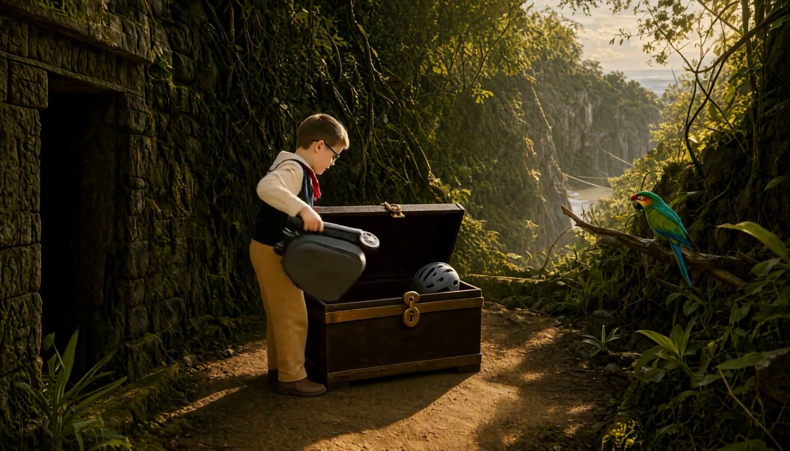

03:33 · Персонаж сам дістає подарунок зі скрині.

### Папуга — одна з удач

Папуга вийшов особливо добре. Для нього я зробив окрему відеовставку: дзьоб намагається рухатися в такт людській піратській репліці. Розбірливе мовлення дала Drama 3, відео — виконання. Синхронізація не ідеальна, але папуга виглядає переконливо: ніби повторює завчену фразу.

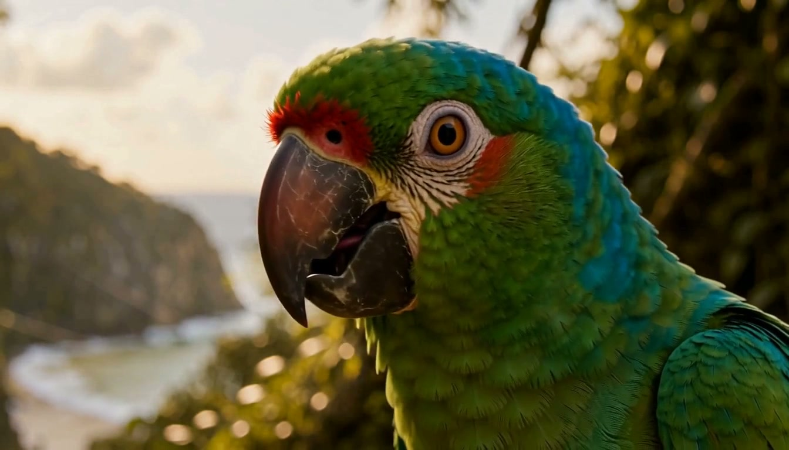

03:24 · Рух дзьоба й окремо згенерований людський голос створюють персонажа.

<a id="speed-reference"></a>

### Поставити швидкість за референсом

Для четвертого випробування мені хотілося більшого, ніж просто пробіжка до воріт. Я приніс аніме-референс із виразними розворотами камери, розмиттям тла та іскрами з-під ніг. Попросив, щоб камера обходила персонажа ззаду вбік і показувала біг у профіль, а на початку були великий план і штрихи швидкості з референсу. На контактному аркуші нижче видно ритм, який я хотів перенести.

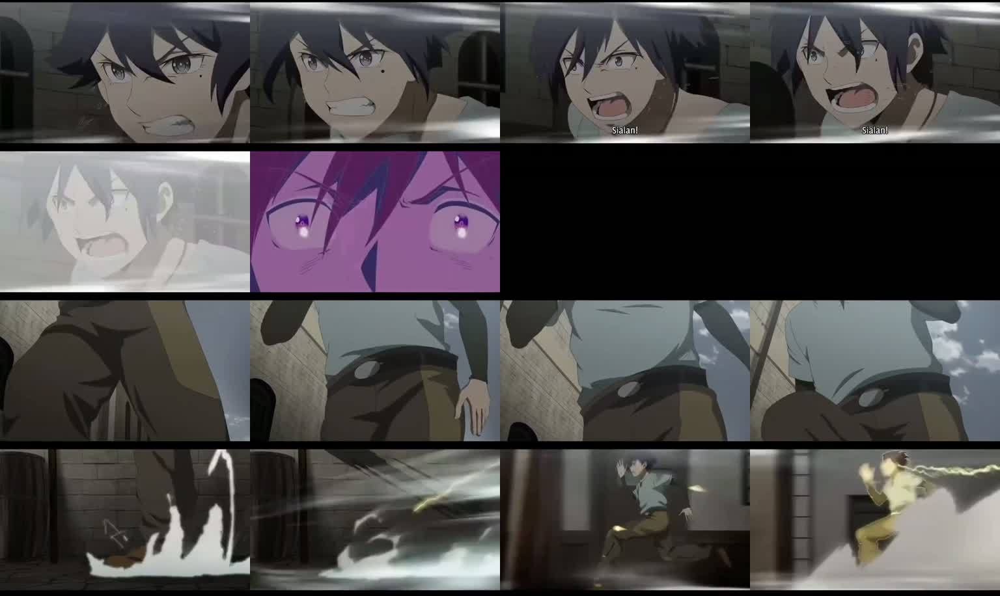

Референс руху · Контактний аркуш з аніме-кліпу, який я надав під час роботи. Це кадри референсу, а не генерації мого фільму.

В одній із перших спроб я подав увесь ролик як відеогайд, і результат скопіював зайве: аніме-стиль і чужого персонажа. У вдалому варіанті залишилися лише зображення мого персонажа й коридору. Увесь референс розібрали на текстову постановку: здивоване обличчя зі штрихами згори та знизу, відстеження ззаду, обхід збоку, розмиті стіни й золоті іскри біля взуття. Штрихи та іскри створила сама FreeVideo всередині кадру.

[Прийнята вставка швидкості v5 · 6,58 секунди, обхід камери ззаду вбік, згенеровані штрихи й іскри, збережена музика та нова репліка.](../article/assets/speed-dynamic.mp4?raw=true)

<a id="artifacts"></a>

## Артефакти генерації

### Мапа для глядача замість мапи для персонажа

На 00:50–00:52 персонаж ніби читає мапу, але її малюнок повернутий до глядача. Без окремого опорного кадру для цієї дії відеомодель поставила персонажа так, наче він демонструє реквізит у камеру. На 03:01–03:03 помилка повторюється, а сама мапа вже відрізняється від тієї, що була на початку. Варто було заздалегідь зробити спільний референс мапи та інших важливих предметів фільму й використовувати його в усіх сценах.

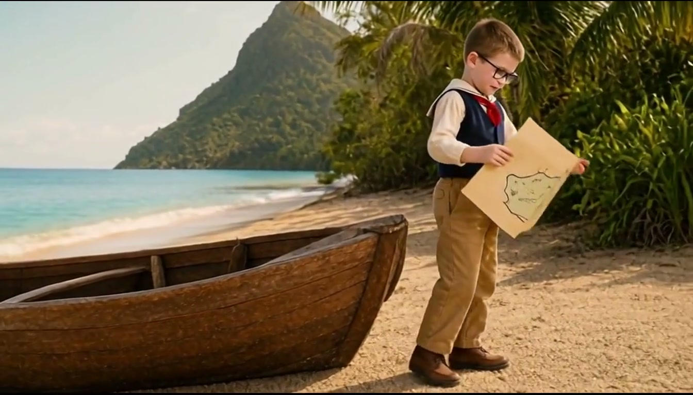

00:50–00:52 · Малюнок мапи видно глядачеві, хоча персонаж має її читати.

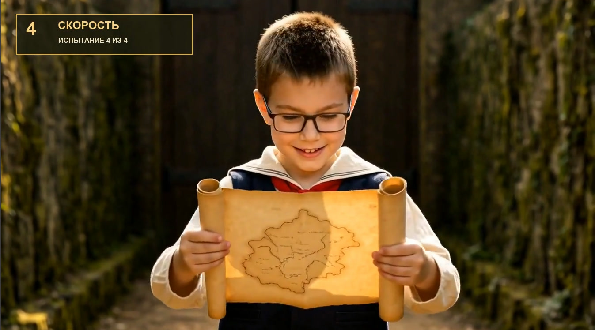

03:01–03:03 · Та сама поза, але малюнок і форма мапи вже інші.

### Опорний кадр моста: референси допомогли не в усьому

Спочатку агент намагався зробити опорний кадр через локальний Qwen. Але замість випробування на сміливість виходив безпечний місток: то короткий перехід майже біля землі, то міцна дерев’яна конструкція з надійними поручнями. Навіть коли з’явилася глибока долина, сам міст виглядав надто ґрунтовним. Спроба замінити дерево мотузками теж іще не дала потрібної ненадійності.

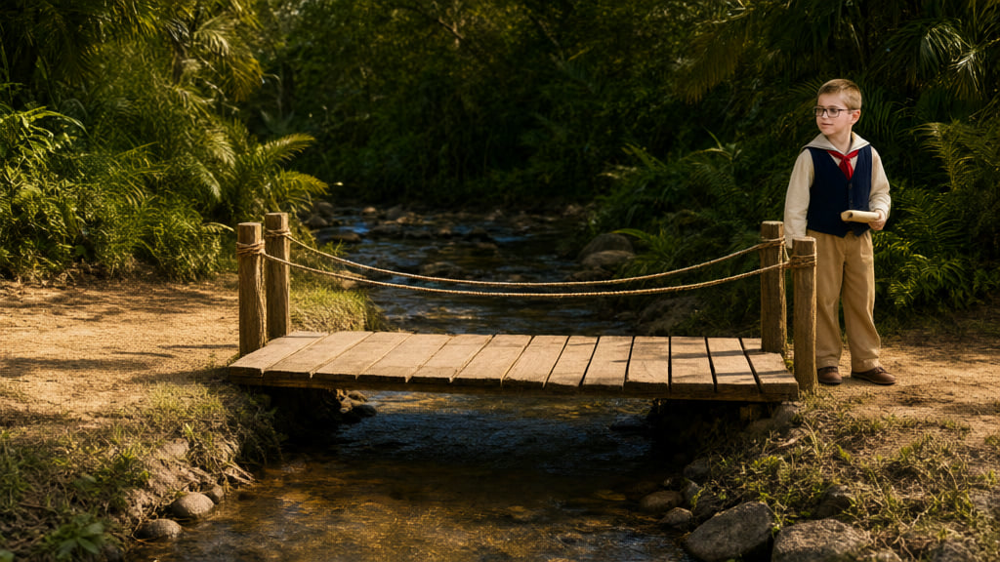

Рання спроба Qwen · Короткий місток над мілким струмком майже не виглядає випробуванням.

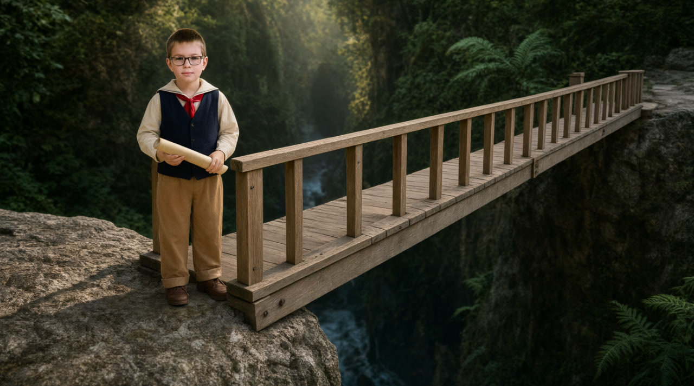

Наступна спроба · Висота з’явилася, але міст нагадує міцний пішохідний перехід.

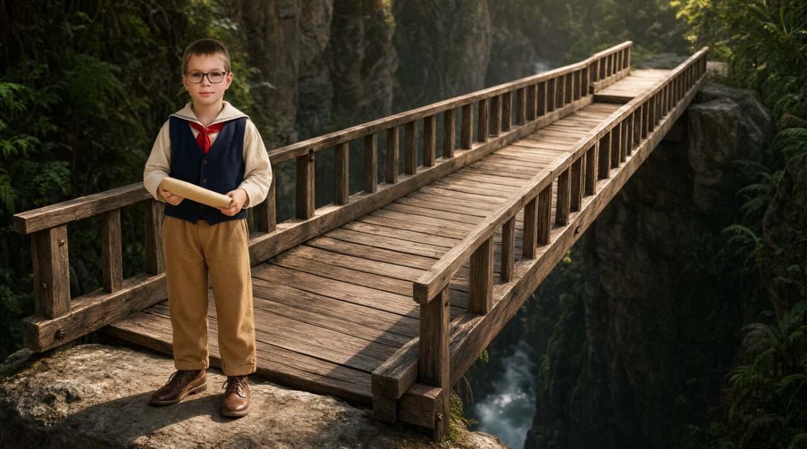

Ще один варіант · Широкий настил і масивні поручні зберігають відчуття надійності.

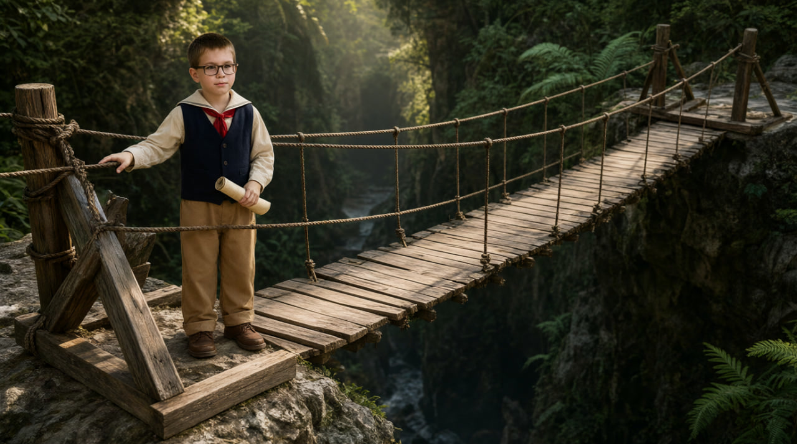

Мотузковий варіант · Матеріали змінилися, але настил і опори досі виглядають надто ґрунтовно.

Бажаний міст вдалося отримати лише після того, як я передав фотографії мостів як референси: довгий підвісний проліт, рідко розташовані дошки й виразний провис. Це допомогло точніше показати, що саме мало виглядати небезпечним.

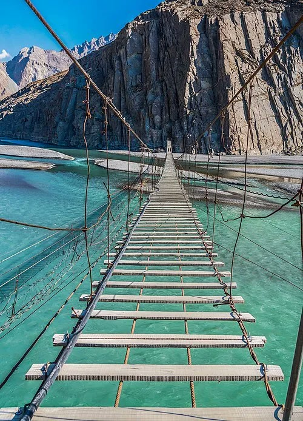

Наданий мною фотореференс · Рідко розташовані дошки й мотузкова конструкція. Це фотографія реального моста, не кадр фільму.

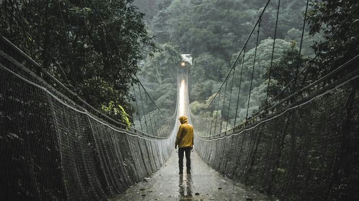

Другий наданий фотореференс · Довгий підвісний проліт і помітний провис. Це фотографія реального моста, не генерація проєкту.

Після референсів з’явилися потрібні масштаб і відчуття небезпеки, але в опорному кадрі залишилися нові помилки: мотузкова огорожа була лише з одного боку, а в персонажа виявилося три руки — одна тримає мотузку, ще дві згорнуту мапу. Агент їх пропустив, хоча інші невдалі картинки часто перегенеровував. Я й сам помітив зайву руку лише ближче до завершення роботи. На той момент я став надто довіряти перевіркам Luna й сам розглядав результати менш уважно. На 00:56–00:58 вона вже перейшла в підсумкове відео. Вирішив залишити цей приклад як нагадування: після поліпшення композиції потрібно заново ретельно перевірити і анатомію, і будову оточення.

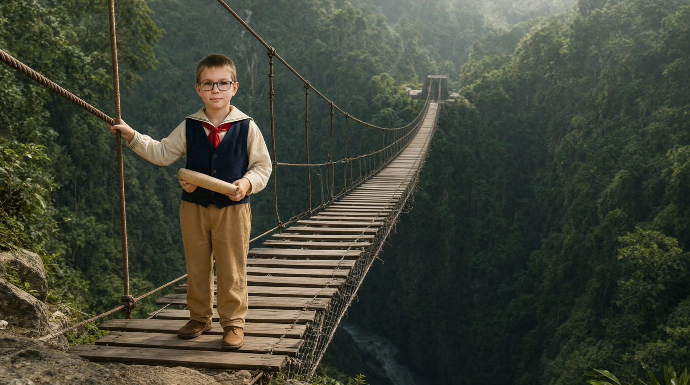

Опорний кадр моста · Зайву кисть уже видно біля згорнутої мапи.

Причина такої довіри була зрозумілою: явний брак Luna часто помічала сама. Наприклад, під час підготовки кінцевого кадру локальній моделі подавали початковий кадр, референс зовнішності персонажа й прохання змінити його положення. Замість того щоб використовувати референс лише для збереження зовнішності, модель додала його в сцену як другого персонажа. Luna відбракувала такий варіант. На тлі цих перевірок зайву руку в кадрі моста було легше пропустити і мені, і агенту.

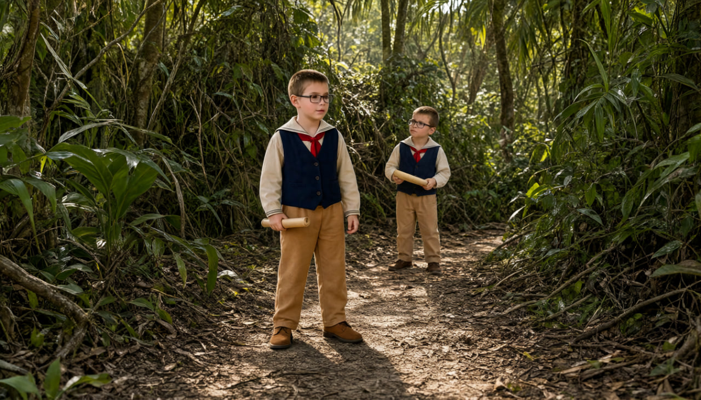

Відбракований опорний кадр · Референс зовнішності перетворився на другого персонажа, хоча потрібно було змінити положення одного.

### Qwen не зрозумів головоломку, GPT Image ускладнив кадри

Для третього випробування не вдалося отримати відповідні опорні кадри через Qwen: у моїх спробах він погано розумів перспективу й саму ідею водяної головоломки. Нижче — ранні варіанти постановки й пізніший кадр GPT Image. Між спробами змінювалися ракурс, форма каналів, положення персонажа та будова механізму.

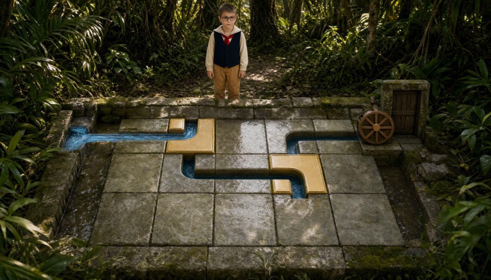

Рання спроба · Персонажа й головоломку показано майже фронтально.

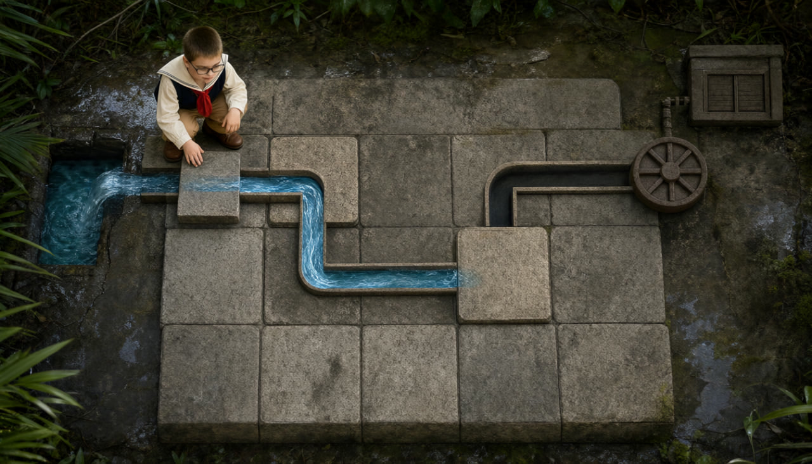

Рання спроба · Вигляд згори та квадратні елементи каналів.

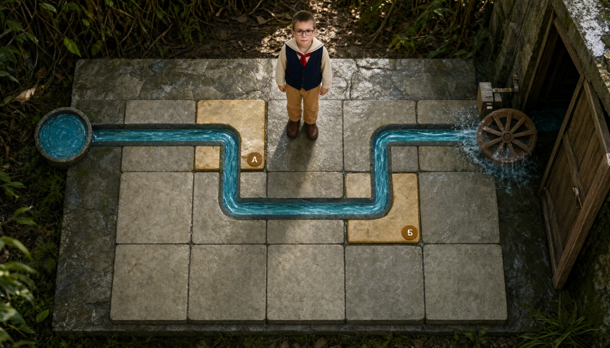

Рання спроба · Інші перспектива, положення персонажа та будова потоку.

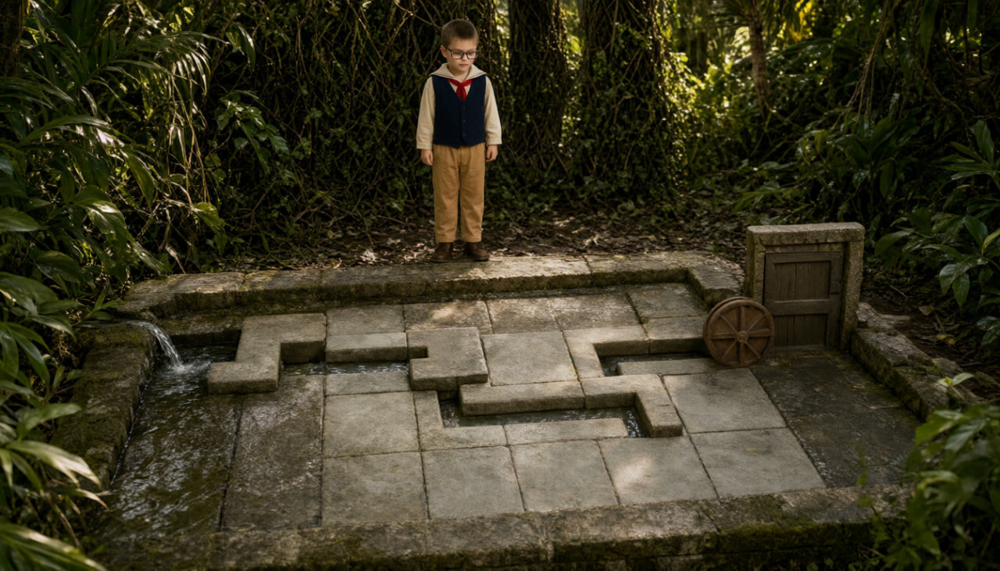

Рання спроба · Змінюються геометрія майданчика й глибина каналів.

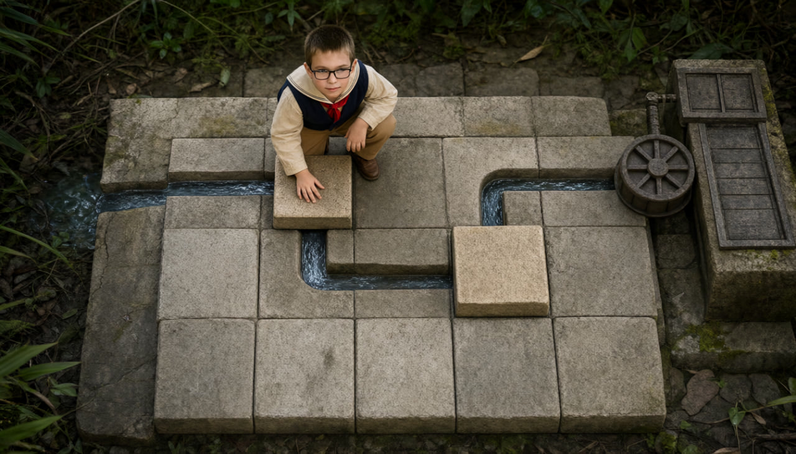

Рання спроба · Новий ракурс взаємодії з квадратним елементом.

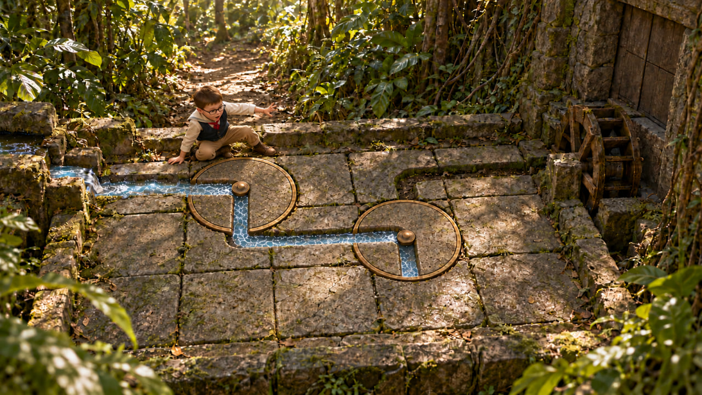

Пізніший кадр GPT Image · Круглі диски й зрозуміліша постановка дії, але багато дрібних деталей.

GPT Image краще зрозумів задум сцени, але його картинки виявилися перевантаженими дрібними деталями й візуальним шумом. Ключові кадри відрізнялися один від одного, а у відео втрачалися обличчя персонажа, деталі та стабільність зображення. Я пробував додавати референс персонажа на етапі відео, а потім пробував без нього. Думаю, якби я вручну підчистив і узгодив ключові кадри GPT Image, ці фрагменти могли б вийти кращими. Такої обробки я не перевіряв.

### «Імітація» води локальною моделлю

Третє випробування було найвимогливішим. Вода мала текти, впиратися в неправильно повернутий канал, після одного руху доходити до наступної перешкоди, а наприкінці обертати колесо. Але модель постійно забувала про рух води: потік залишався нерухомим, хоча дія сцени залежала саме від нього. Усе ж один вдалий момент вийшов — у кліпі нижче після правильного повороту диска вода проходить далі каналом. У цьому фрагменті MiniMax здивувала мене тим, наскільки переконливо виглядав рух.

[Випробування 3 · Правильний перший поворот: вода проходить крізь диск А й зупиняється всередині Б; колесо ще нерухоме.](../article/assets/water-first-turn.mp4?raw=true)

У промпті доводилося уточнювати й нерухомі об’єкти: колесо не мало починати обертатися лише тому, що десь у кадрі є вода.

### Вода піднімається стінкою

В опорному кадрі розв’язаної головоломки змістився струмок: вихід каналу опинився нижче точки подачі води на колесо. Відеомодель продовжила цю геометрію, і потік пішов угору кам’яною стінкою просто в колесо. У русі це менш помітно, але послідовність стоп-кадрів добре показує порушення фізики. Вдалий поворот першого диска вище не означає, що вся водяна сцена вийшла правильно.

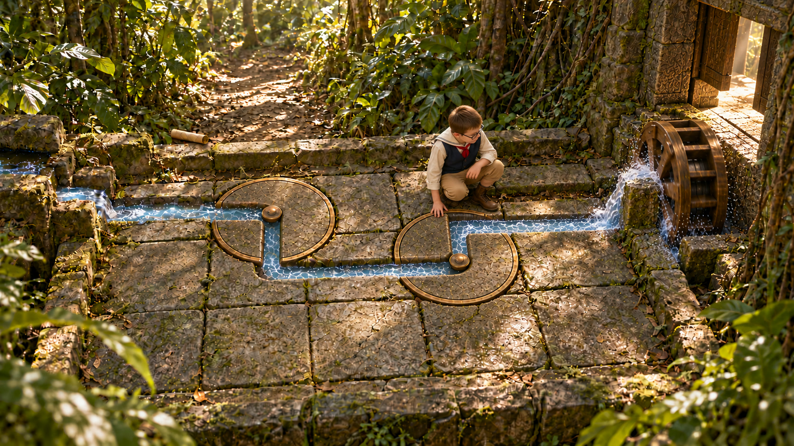

Опорний кадр розв’язаної головоломки · Між каналом і колесом уже порушено перепад висот.

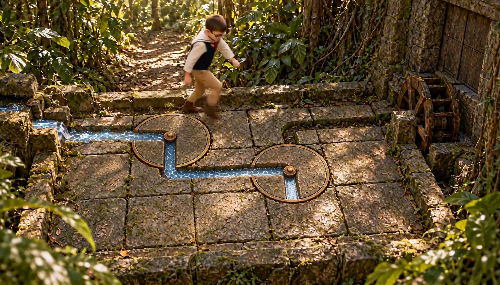

02:23 · Перед поворотом другого диска.

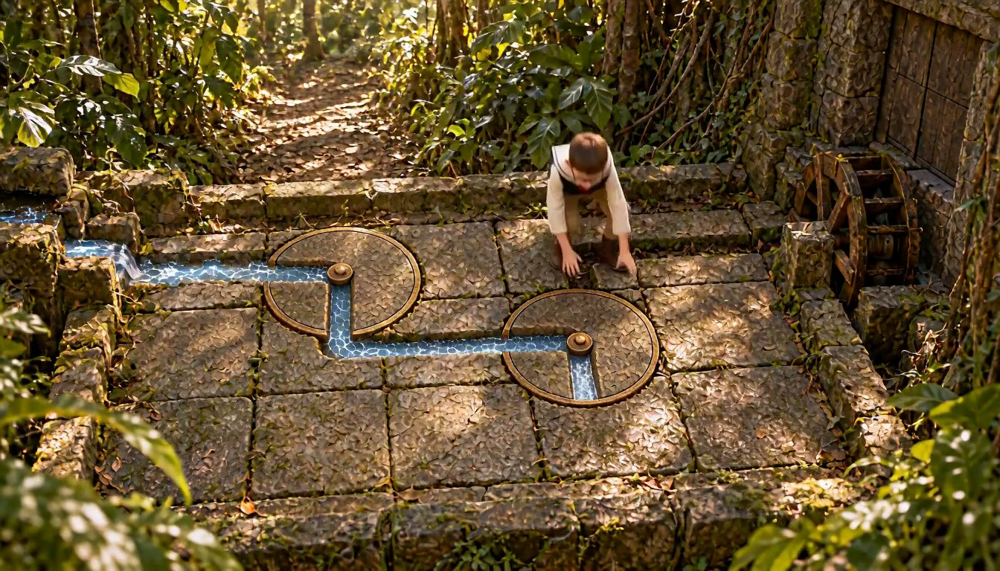

02:24 · Диск змінює положення.

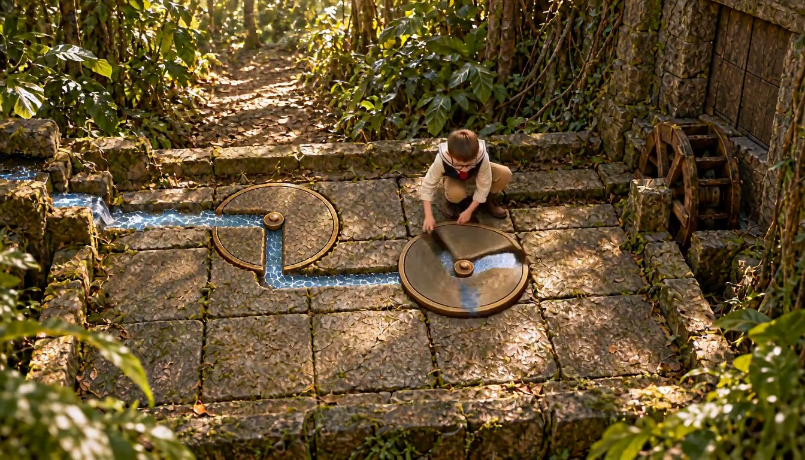

02:25 · Вода доходить до виходу каналу.

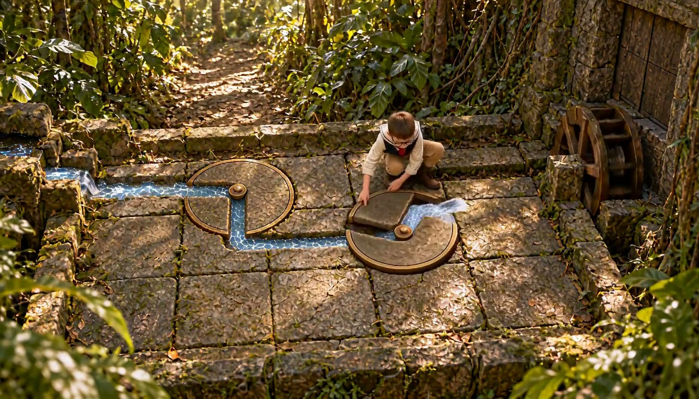

02:25,2 · Канал закінчується нижче точки подачі на колесо.

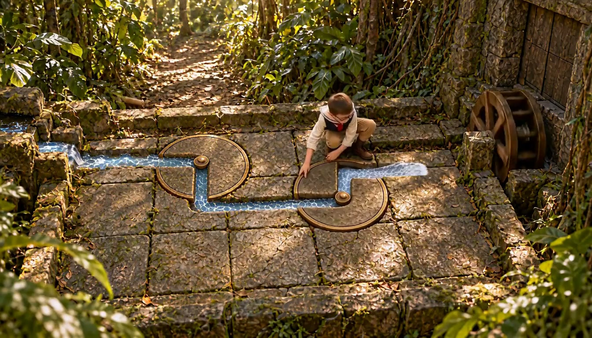

02:25,4 · Потік починає підніматися вздовж стінки.

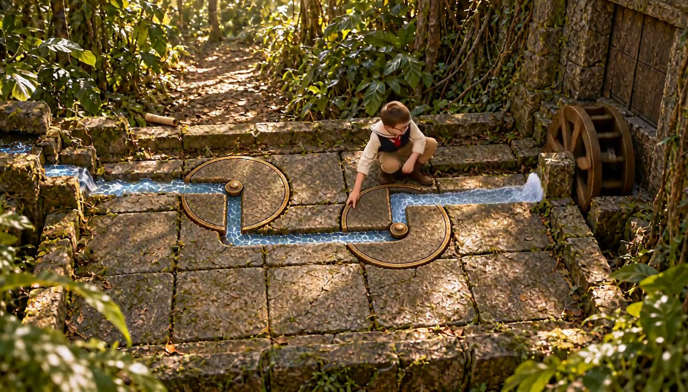

02:25,7 · Вода досягає верхньої частини кам’яного виступу.

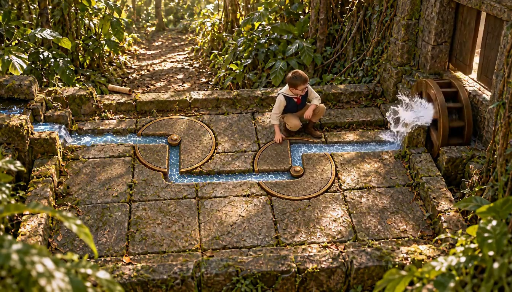

02:26,1 · Потік і бризки піднімаються до колеса.

### Перевертання пісочного годинника

На 02:34–02:36 модель погано перевернула пісочний годинник: замість зрозумілого обертання скляної частини вийшла непереконлива деформація. Пісок і механізм виглядали слабше за вдалий рух води чи роботу камери. Я залишив цей фрагмент у фільмі як приклад помилки.

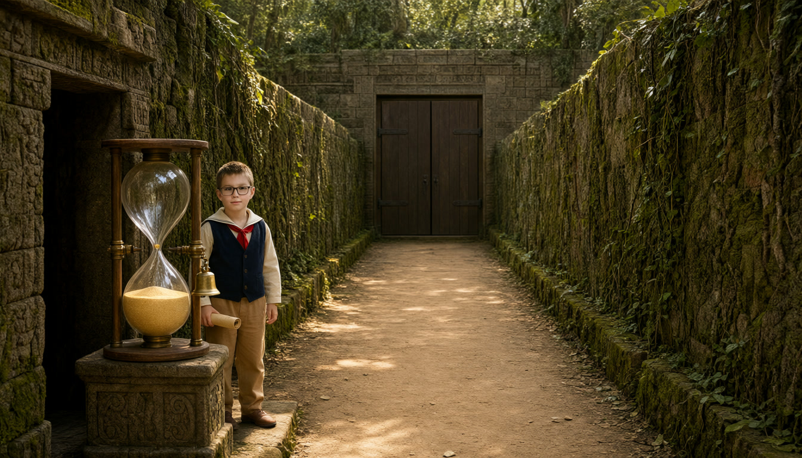

Початковий стан · Пісок унизу, ворота зачинені.

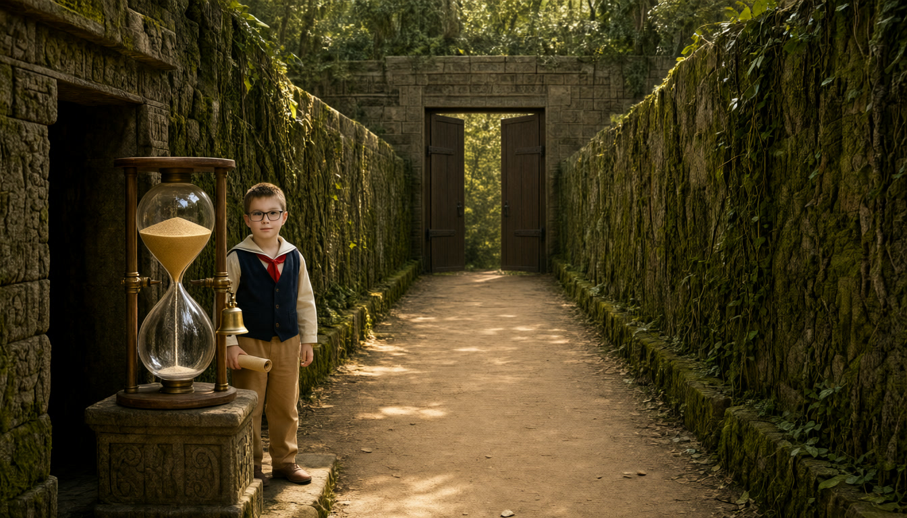

Опорний кадр таймера · Пісок угорі, ворота відчинені. Це стан після запуску, а не проміжна фаза перевертання.

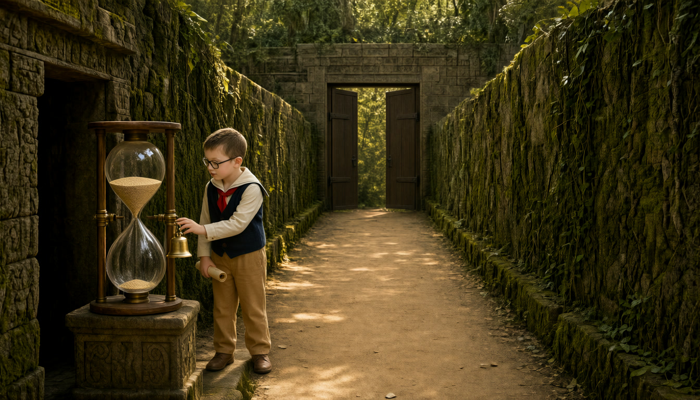

Фактичний кінцевий кадр відеозавдання · Персонаж торкається дзвіночка; пісок уже вгорі.

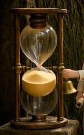

02:34–02:36 · Непереконливий проміжний стан годинника у відео.

Я перевірив збережені prompt.txt і media.json завдання scene09-start-v1. У промпті прямо сказано: після дзвінка скляна частина перевертається на горизонтальних бічних осях, дерев’яна стійка залишається нерухомою, а пісок переміщується разом зі склом. Тобто саму вказівку на перевертання не забули. Фактичними входами були початковий кадр і кадр дотику до дзвіночка, а не показана вище пара establish/timer. Жоден із них не показує проміжної фази обертання.

За цими матеріалами я бачу дві можливі складності: модель мала сама відновити траєкторію перевертання між кінцевими станами, а в ті самі 6,5 секунди вмістити дзвінок, рух піску, відчинення воріт і реакцію персонажа. Це можливі причини, а не доведений діагноз. Виразніший проміжний кадр і окремий короткий план перевертання варто було б перевірити в наступній спробі.

[02:34–02:36,5 · Фрагмент підсумкового фільму: помилку перевертання видно в русі.](../article/assets/artifact-hourglass.mp4?raw=true)

### Мовлення відеомоделі перетворюється на нерозбірливі звуки

На 02:58–03:01 у фільмі залишився приклад невдалого мовлення. У моїх генераціях відеомодель погано справлялася з голосами мовами, відмінними від англійської: замість зрозумілої репліки з’являлися нерозбірливі звуки. Я вирішив зберегти цей момент як приклад обмеження. Для розбірливого російського мовлення в інших репліках я використовував Drama 3.

[02:58–03:01 · Оригінальний звук підсумкового фільму збережено: тут важливе саме нерозбірливе мовлення.](../article/assets/artifact-speech.mp4?raw=true)

<a id="film"></a>

## Чотири хвилини локального кіно

[Дивитися фільм](../article/assets/film.mp4?raw=true)

Робоча збірка v3 · 4:10,250 · російське мовлення

<a id="story"></a>

## Від піратського досьє до падучої зорі

Далі — весь сюжет, включно з подарунком і фіналом.

Усе почалося з дев’ятого дня народження та подарунка — сірого двоколісного самоката. Я хотів, щоб він став нагородою наприкінці пригоди. У початковому «Острові дев’яти скарбів» скарби відповідали рисам і побажанням: сміливості, допитливості, кмітливості, швидкості, спритності, наполегливості, вірним друзям, удачі та великій мрії. Через тривалу генерацію й обмежений час я скоротив маршрут до чотирьох випробувань. Назва зберегла зв’язок із дев’ятиріччям.

Піратську атмосферу й жартівливо-серйозне досьє підказав «Острів скарбів». Досьє я зробив мальованим, а решту сцен — із фотореалістичним персонажем за фотографічними референсами.

### Корабель, тека й мапа

Вітрильник наближається до острова з бухтою. У каюті пірат кладе на стіл теку з особовою справою. Досьє представляє дев’ятирічного шукача пригод, а штамп приймає його до команди. На палубі вже фотореалістичний персонаж отримує мапу й завдання пройти чотири випробування. Човен доправляє його на берег; він перевіряє маршрут і йде в джунглі.

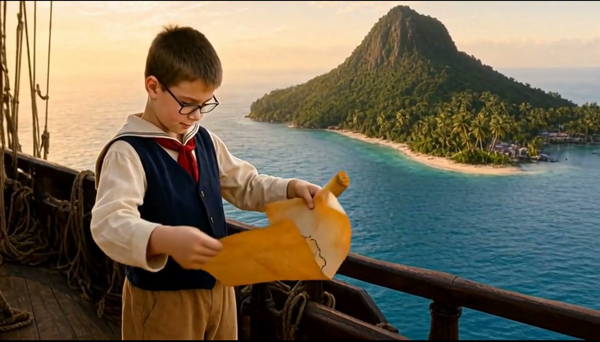

00:42 · Отримання мапи. Навіть волосся на вітрі допомагає повірити в морську сцену.

### Перше випробування: сміливість

Попереду довгий підвісний міст над глибокою долиною. Він хитається, камера облітає його й показує висоту, одна з дощок тріскається. Персонаж в останню мить дістається іншого берега. Лише після приземлення з’являється досягнення «Сміливість».

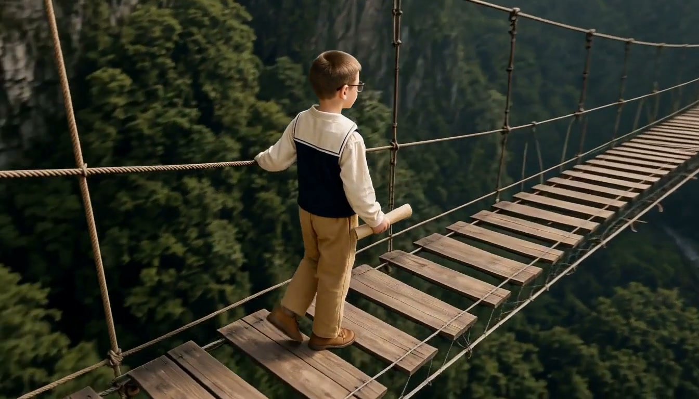

01:04 · Мосту знадобилися переконлива висота, ненадійні дошки та рух.

### Друге випробування: допитливість

Стежка впирається в ліани. Камера показує глухий кут очима персонажа ще до його появи в кадрі. Він озирається, чухає голову й помічає мушлю, що блимає на знаку: «О!» Підходить і власноруч повертає дошку. Тієї ж миті зарості розходяться та відкривають шлях. Персонаж іде з мапою в прохід і здобуває досягнення за допитливість.

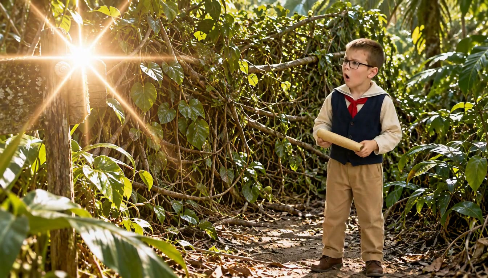

01:31 · Знак повертається від дії персонажа, і слідом відкривається прохід.

### Третє випробування: кмітливість

За проходом кам’яний майданчик: канали, вода, два круглі поворотні диски, колесо та зачинені двері. Я побудував головоломку за принципом гри «сантехнік». Персонаж кладе мапу й неправильно повертає диск. Спроба вирішити все силою теж не допомагає: поки він крутить колесо руками, двері відчинені, але варто відпустити його й витерти піт — вони знову зачиняються.

Потрібно з’єднати маршрут води. Після правильного повороту першого диска потік доходить до другої перешкоди. Після другого — досягає колеса й обертає його, утримуючи двері відчиненими. Тепер персонаж може залишити механізм і пройти далі. Третє досягнення — за кмітливість.

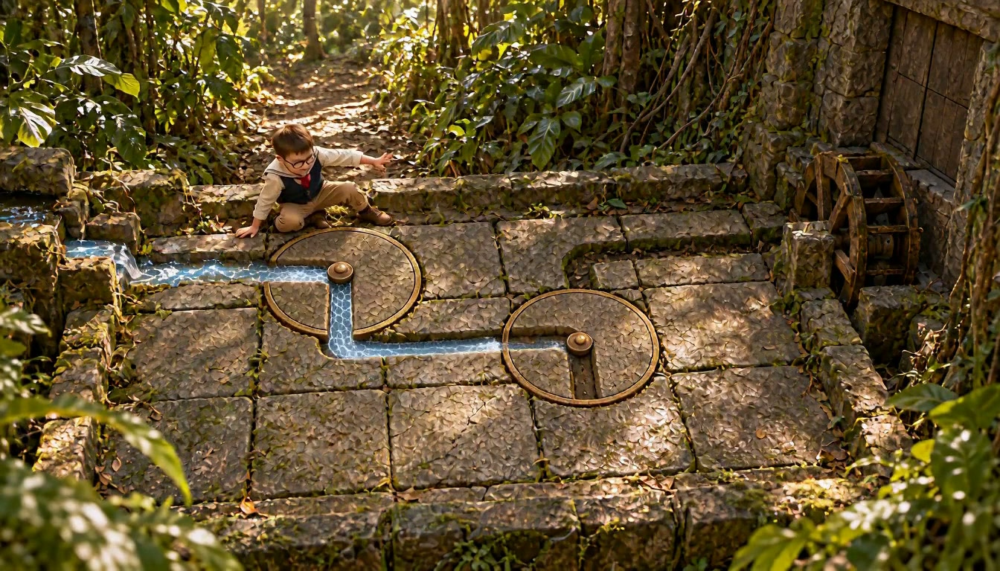

02:21 · Положення дисків визначає, куди справді може пройти вода.

### Четверте випробування: швидкість

Дзвіночок запускає великий пісочний годинник і відкриває дальню хвіртку. Персонаж задивляється на пісок, поки час уже спливає. Потім ховає мапу й зривається з місця. Монтаж чергує біг, пісок, що пересипається, і прохід, який зачиняється. Він встигає, переводить подих і отримує четверте досягнення. Залишається дістатися до позначеного скарбу.

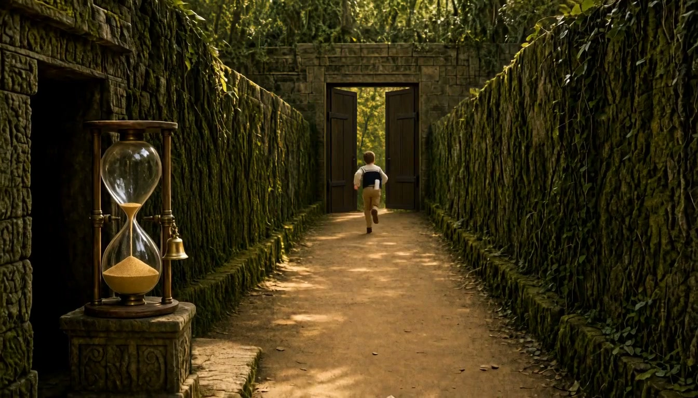

02:54 · Забіг на час до проходу, що зачиняється.

### Скриня та незвичайне судно

Над бухтою персонаж знаходить скриню, ховає мапу: «Ось ти де!» Сам піднімає кришку. Усередині складений сірий самокат і шолом. Диктор оголошує новітнє досягнення кораблебудування, а поруч зі скринею з криком прокидається папуга та промовляє завчений піратський жарт.

> «Два колеса, одне кермо, жодної гармати. Зате яка швидкість!»

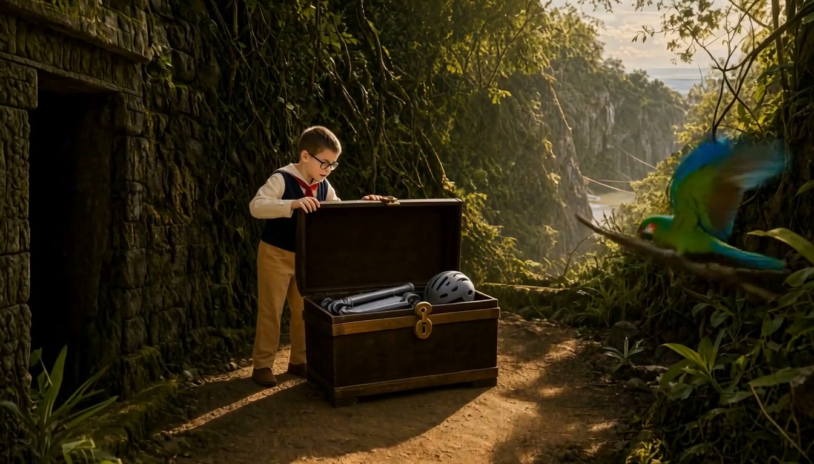

03:16 · Персонаж тримає кришку, а папуга завершує відкриття подарунка жартом.

### Нічний спуск і привітання

Я вирішив завершити історію в дусі серії Tomb Raider: після знахідки скарбу персонаж спускається похилим тросом просто на пляж. Самокат поміщається в чохол. В остаточній постановці персонаж тримається обома руками за руків’я підвісного ролика — замість розглянутого раніше варіанта з льодорубами.

День змінюється ніччю. Диктор доручає новому капітану відкривати маршрути й не забувати про шолом, а персонаж спускається до бухти. На пляжі персонаж уже із шоломом і самокатом дивиться на зорі, що спалахують. Падаюча зоря супроводжує завершальне побажання з днем народження.

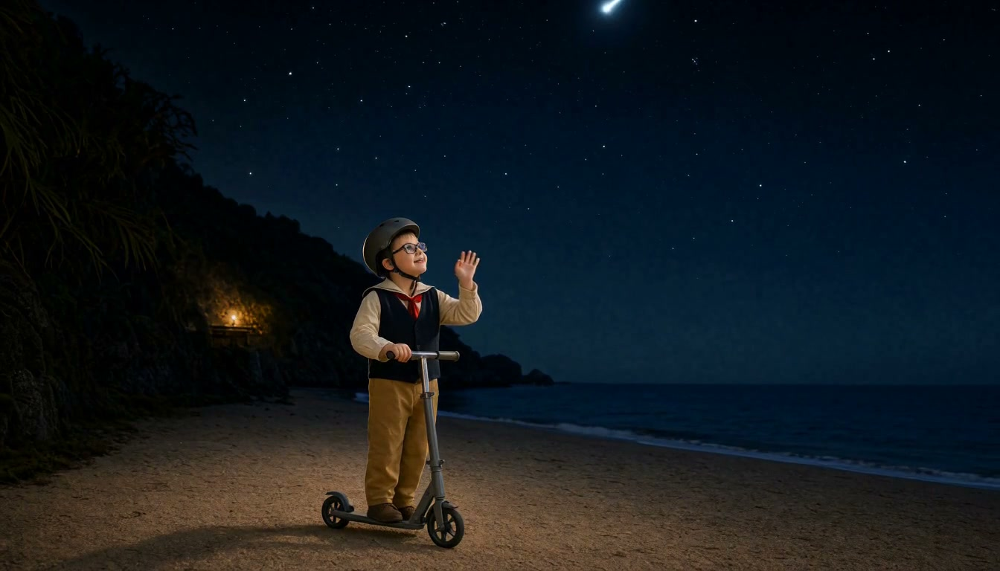

04:06 · Пригода закінчується особистим привітанням на березі.

### Про матеріали

Я відновив цю розповідь за робочими чатами, журналами сцен, workflow і таймлайном v3. Ілюстрації включають кадри фільму, початкові опорні зображення та надіслані мною фрагменти; підписи їх розрізняють. Таймкоди стосуються підсумкової збірки. Порівняння моделей, рух води, деградація картинок, швидкість і RAM — спостереження моїх спроб, а не контрольовані бенчмарки.

Музика: Kevin MacLeod — Adventures in Adventureland, CC BY 4.0, змонтована та зведена з репліками й ефектами. Море: Joseph Sardin / BigSoundBank, CC0. Інструменти й моделі зберігають ліцензії своїх розробників.

[Credits](../CREDITS.md)
